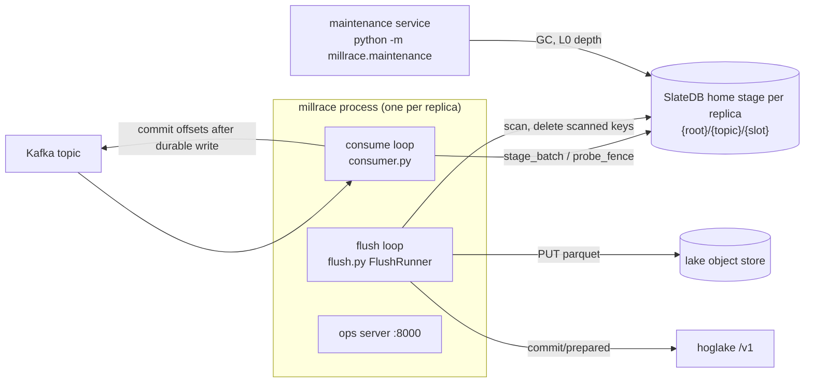

# millrace architecture

How millrace works. Operator summary: [README.md](README.md). Design
rationale: [docs/kafka-ingestion.md](../docs/kafka-ingestion.md). Code
references are `module.py:symbol` under `millrace/millrace/`.

## 1. Contract

One durable queue (Kafka) into another (hoglake) through durable
staging (one SlateDB instance per claimed Kafka partition).
**At-least-once**: no loss, duplicates accepted. Every mechanism below
exists to prevent loss, to bound memory, or to keep files correctly
laid out; nothing exists to prevent duplicates beyond the server's
receipt for identical-bytes retries within one process.

| Guarantee | Mechanism |
|---|---|
| A committed Kafka offset's record is durable in staging, or was dropped as unrepresentable and counted | The offset commit follows `await_durable` of every touched partition's write; an all-dropped poll writes a durable fence probe instead (§4) |
| A staged row is deleted only after every commit naming it landed, or it was a counted drop | The delete batch holds exactly the scanned keys and runs after the last commit returns (§5) |
| Every staged row is eventually flushed | The startup drain (§6) plus an in-memory index that can never lose a group with rows (§3), plus a predicate under which every group becomes due (§5) |
| No group wedges | A scan always returns ≥ 1 row; per-record drops never fail a batch; any failure retries with backoff (§5) |

What duplicates look like: a crash (or a failed delete) after a commit
landed re-flushes that window under a new key; a Kafka rewind re-stages
already-flushed records. (A split decision that fails partway does not
duplicate: each commit's rows are deleted as soon as it lands.)

## 2. Shape

The consume loop and the flush loop are asyncio tasks on one loop
sharing one `stage.py:StageManager`. Blocking work stays off the loop:
librdkafka on one dedicated thread; record classification, WriteBatch
construction and payload lowering on worker threads; pyhoglake I/O and
the parquet build on the flusher's pool; the ops server on its own
thread.

| Entry point | Exit codes |
|---|---|
| `millrace` (`main.py:main`) | 0 clean stop; 1 failure; 2 invalid config or assignment refusal; 3 halted (destination recreated, or no `read_snapshot_id`); 4 fenced. Fenced outranks halted outranks the rest (`main.py:_exit_code_for`) |
| `python -m millrace.maintenance` | 0, 1, 2 |

## 3. Staging data model

**One SlateDB per replica: its home stage** at
`{stage_base_path}/{topic}/{slot}`, the slot of the smallest partition
it claims (its ordinal, under `p % R == ordinal`). The home holds every
claimed partition's rows, so a group is one key range per replica
whatever the partition count; `(partition, offset)` makes a row key
unique. At startup the replica probes every slot `j` with `j % R ==
ordinal` below `max(1024, partition count)` for a SlateDB manifest
(`StageManager.existing_slots`, through SlateDB's own store; a probe
error fails the start) and also opens every other existing one
(the home of a replica a scale-down removed) to
drain it; a foreign stage is closed once its index is empty
(`StageManager.close_idle_foreign`) and is never written by the
consumer. For a fixed `R` the replicas' slot sets are disjoint.
Replica-count changes are coordinated on the Kubernetes side (scale to
zero, change `R`, scale up): a mixed-`R` fleet is unsupported.

**Keyspace** (`keyspace.py`):

| Key | Value |
|---|---|
| `rows/` + group + partition (u32 BE) + offset (i64 offset-binary) | raw Kafka payload |
| `meta/fence` | the probing poll's last handled offset (i64; forensic) |
| `meta/table_uuid` | the destination incarnation first committed to |

Any other key (an older build's `stats/`, `sched_age/`, `prepared/`,
`flushed/`) is deleted during the startup drain, alongside the row
stream (`PartitionStage.delete_foreign_keys`: read-ahead scans, bounded
delete batches; a failure is logged, never drain-fatal).

**Group** = one partition tuple of the destination under the live spec
at consume time: per spec field, the wire string a file of that tuple
carries in `partition_values` (None for null), computed by
`grouping.py:GroupKeyer` with the same coercion and transform the flush
fanout uses. The encoding is prefix-free (`arity u8`, then per
component `0x00` or `0x01 len u16 utf8`), so a group's rows are one
contiguous range (`group_rows_range`) that never reaches another
group's rows, even `(a,)` vs `(a, b)` after a spec change. Within a
group rows sort by `(partition, offset)`, so a scan cut by the byte
budget is a key prefix, not one partition's offset prefix, and a
settle deletes exact keys (a range delete would take rows staged after
the scan).

**In-memory index** (`stage.py:GroupState`, per stage): per group,
`first_staged_ts`, `staged_bytes`, `rows`, and `gen`, the stage-wide
write generation of the last batch that touched it. Nothing about
groups is persisted. Invariant I2: *a group with rows on disk is in the
index*. It holds because:

1. A stage opens with an EMPTY index. Before any consumer write the
   startup drain (§6) reads every row in one pass and flushes it; a
   group whose window fails is entered in the index (`RowStream.hold`)
   with the rest of its rows counted, so after the drain the index
   holds exactly the groups that still have rows. (Opening used to
   discover groups with one fresh default-options seek per group:
   several sequential GETs each, ~270 ms per group at 60 ms latency,
   partition after partition — the 18-minute unready startup on a
   many-group backlog.)
2. `stage_batch` updates the index **before** its write, under the
   write lock.
3. A group leaves the index only in `settle` / `settle_many`, under
   the lock and after the deletes are durable, when the settled scan
   was complete AND the group's `gen` is unchanged since the scan read
   it (under the lock, before the scan began). Every write with an
   older gen had returned before the scan iterator was created, so the
   scan saw its rows; any newer write blocks removal.

`staged_bytes`/`rows` over-count after a redelivery and are
approximate for groups the drain held. Only the size lane and gauges
read them.

**The write lock** (one `asyncio.Lock` per stage) covers writes only:
the index update and `db.write(batch)`. The durability wait runs after
the lock is released (scans read at MEMORY durability, so visibility
needs only the write; a row published before its put is durable is at
worst replayed from Kafka: a duplicate), so one stage's consumer is
never serialized behind settles' WAL flushes. No scan, no
`next_batch`, and no payload lowering ever runs under it: batches are
built on a worker thread first (`_build_stage_batch`,
`_build_delete_batch`). Pinned by the lock spies in `tests/test_stage.py`.

**Compression**: SSTs are zstd (`build_slatedb_settings`); staged rows
are raw event JSON.

**Scans** use `_bulk_scan_options`: 4 MiB read-ahead, 4 fetch tasks,
blocks not cached (slatedb's default fetches one ~4 KiB block per GET).

**Binding patch** (`slatedb_patch.py`, applied at import of
`stage.py`): the generated `_UniffiRustBufferBuilder.write` copies each
lowered value one byte per Python iteration; it is replaced with one
`ctypes.memmove` into the region the binding's own `_reserve` context
grew. Shape check and a self-test round trip first; on any mismatch the
binding is left alone with a WARNING. `tests/test_slatedb_patch.py`
round-trips every byte value and lengths 0 to 1 MiB.

## 4. Consume loop

`consumer.py:MillraceConsumer._step`, one cycle:

1. Refresh the keyer when the shape TTL passed (a re-read naming
   another `table_uuid` raises `FlushHalted("table_recreated")` before
   the poll: exit 3).
2. Poll up to `consume_batch_size` records, clamped to
   `consume_batch_max_bytes ÷` the observed mean record size.
3. Classify on a worker thread (`classify_message`): strict JSON object
   → stage under the keyer's tuple; anything else → `DroppedRecord`
   (counted, rate-limited log).
4. ONE home-stage write for the whole poll: `stage_batch` (one
   durable WriteBatch holding every partition's records), or
   `probe_fence` when every record of the poll was dropped (an empty
   batch cannot serve; SlateDB refuses it).
5. FENCED → close the home stage locally, raise
   `stage.FencedError` (exit 4) with no offsets committed. Any other
   failure raises (offsets unadvanced, restart replays).
6. Commit `last handled + 1` per partition, once, synchronously
   (3 attempts).

**Assignment** (`MillraceConsumer.start(drain)`): partition count from
metadata once (transients retried), `compute_assignment` (`p %
replicas == ordinal`; empty share → `AssignmentError`, exit 2),
`StageManager.existing_slots` and `claim` (open the home and the slots to
drain; nothing is read), **the drain**, a
coordinator warmup (`committed()` probes; librdkafka resolves
`OFFSET_STORED` once at assign time and never retries), then
`assign(OFFSET_STORED)`. A failed start is sticky.

`auto.offset.reset` is `latest` by default (fleet policy). Offsets
lost (group id change, retention) skip the backlog under `latest`;
`earliest` replays all of retention as duplicates.

librdkafka config: auto-commit and auto offset store off, fetch
defaults sized for a hot partition (`KAFKA_FETCH_DEFAULTS`), then the
`MILLRACE_KAFKA_CONSUMER_*` passthrough last (keys millrace owns are
refused at config time).

## 5. Flush loop

`flush.py:FlushRunner.run` every `flush_sweep_s` (1 s): for each open
stage, for each group in the index, compute whether it is due; launch
the due groups not already in flight, oldest first. A size-lane or
backlog group, or one whose last failure split it out of a batch,
is a decision alone; every other due group of a stage is packed into
**batches** of at most `flush_bytes` staged and `max_files_per_commit`
groups. Every decision takes the same path (`FlushRunner._flush`):
scan its groups, at most 8 at once, each capped at its indexed
estimate plus an even share of the budget the batch leaves unused (so
the caps sum to `flush_bytes`; a group under 1 MiB scans with 64 KiB
read-ahead), then `HoglakeFlusher.flush_batch`. A process-wide semaphore
(`flush_concurrency`, 4) bounds the decisions running at once. A
sweep reads only memory, in place: the index is not copied.

**Due** (`planner.py:decide`, first match):

| Lane | Condition |
|---|---|
| size | `staged_bytes ≥ flush_bytes` |
| slow | `age ≥ slow_lane_deadline_s` |
| age | `age ≥ flush_deadline_s` and `staged_bytes ≥ min_flush_bytes` (1 MiB) |

A group whose last attempt failed is due again when its backoff
expires (2 s doubling to 120 s), regardless of the predicate. The
drain's retry pass (§6) treats every indexed group as due.

**One group within a decision**:

1. `PartitionStage.scan(group, max_bytes=cap)`: a key prefix of at
   most its cap of payload, always ≥ 1 row.
2. Build (`build_flush_plan`, pure, on the pool) against the cached
   shape (re-read `totals=false` past a TTL of a quarter of the
   catalog's retention, or after any commit error): decode each payload
   with the column coercers (`coerce.py`; a value no column can hold is
   dropped and counted; unknown top-level keys are dropped from the row
   and warned once); build Arrow (one record that defeats the batch
   build is isolated and dropped); sort by the live sort spec; fan out
   by the live partition spec, one parquet file per tuple; chunk the
   files into commits of at most `max_files_per_commit` (512).
3. Per commit: upload every file (objects at
   `{data_path}/data/{ns}/{table}/{build}/{index}.parquet`, `build` a
   fresh token per build), then publish with a fresh uuid4
   `idempotency_key`, `read_snapshot` from the shape read and the
   pinned `expected_table_uuid`.
4. As each commit lands, `PartitionStage.settle` deletes exactly the
   scanned keys whose rows it published (the plan carries a row
   index through the sort and fanout), in one durable batch, and
   updates the index (§3); counted drops go with the first commit.
   A rebuild after a refused read basis covers only the unpublished
   rows. An incomplete scan marks the group due on the next sweep.

Timestamps outside years 1–9999 are clamped at decode (`coerce.py`,
every timestamp type, ints and ISO strings) so the keyer, the
partition transforms and the Arrow build see the same value;
counted in `millrace_values_clamped_total{column}`. An Arrow build
failure after total coercion is an encoder bug: the decision fails
with every row staged (never a drop).

The first commit from a stage pins the destination incarnation in
`meta/table_uuid`; the drain checks it before flushing anything, so a
recreated table halts in every later process, not only the one that
saw it.

**Commit ladder** (`HoglakeFlusher._publish`):

| Answer | Action |
|---|---|
| 5xx, 408, 429, transport error | resend identical bytes, same key (≤ 8 attempts, exponential, floored by `Retry-After`) |
| 409 `commit_conflict` | resend identical bytes (≤ 5) |
| 409 `ddl_since_read_snapshot`, 410 `read_snapshot_expired` | rebuild on a fresh shape with a fresh key (≤ 3 builds) |
| 409 `table_recreated` | `FlushHalted` (exit 3) |
| other 4xx (400/422 payload refusal, 401, 403, 404, 413, 409 `table_dropped`) | `CommitRefused`, counted by status; the decision stops and its unpublished groups split out |
| ladder exhausted | `CommitExhausted`; the decision fails; its objects may be live, so they are counted as ambiguous (`millrace_flush_ambiguous_uploads_total`), never as orphans |

**Batched decision** (`HoglakeFlusher.flush_batch`, the only flush
implementation): every group of the decision is built on ONE shape
read, in parallel on the pool. Rows the decoder drops are settled
right after the build (never published; a rebuild cannot drop them
twice). The files are packed into commits of at most
`max_files_per_commit` (normally one commit); as each commit lands its
groups' rows are deleted in ONE batch (`PartitionStage.settle_many`:
one write, one durability wait), tracked by position in the scan, not
by key. The outcome is a `BatchReport`: a report per finished group,
the groups whose BUILD failed (rows staged; each retries alone), and,
when a commit was refused (`CommitRefused`), the groups it left
unpublished with the refusal: each retries ALONE (the split), which
isolates a poisoned group. A refused read basis rebuilds the
unpublished rows on a fresh shape (≤ 3 builds). Any other failure
(transport, ladder exhausted) raises and retries the decision whole,
so a hoglake outage never turns into one commit per group when it
recovers.

**Failure rule**: any failure fails the decision; nothing is deleted;
the group retries with backoff; after `STUCK_AFTER` (3) consecutive
failures it logs ERROR `flush STUCK`, increments
`millrace_flush_groups_stuck_total` and stays in
`millrace_flush_groups_stuck` until it succeeds. Other groups are
unaffected. Objects uploaded for a commit that did not land are logged
by name and counted as orphans.

**Terminal conditions**: a `FlushHalted` (`table_recreated`: the shape
read or the commit names another incarnation; `server_capability`: no
`read_snapshot_id`) and a FENCED stage (`stage.FencedError`) latch on
the runner, stop it, and re-raise from `run`, `run_once` and `drain`.

## 6. Startup drain and restart

`main.py:_run` → `consumer.start(drain=runner.drain)`:

1. Claim and open the stages (no reads; the index starts empty).
2. `FlushRunner.drain`:
   - check every stage's pinned incarnation (`meta/table_uuid`): a
     recreated destination halts before anything is flushed;
   - **stream** each stage (the home and the foreign slots),
     stages concurrently (`_drain_partition`): ONE iterator over
     `rows/` with the bulk read-ahead options (`stage.RowStream`), cut
     into windows of one group each, at the group's last row or where
     the next row would exceed `flush_bytes` (always ≥ 1 row).
     Consecutive windows are packed into batches (at most about
     `flush_bytes` and `max_files_per_commit` windows; a window that
     would overflow a non-empty batch starts the next one), each
     flushed by `HoglakeFlusher.flush_batch` as the stream proceeds.
     The stream reads with less read-ahead than a window scan (1 MiB ×
     2 fetches per SST iterator; it is open per stage for the whole
     drain), pages of at most 1,024 rows / ~16 MiB, and reopens just
     past its last key every 60 s and after a read error (up to 3 in a
     row): a long-lived iterator would pin SSTs the compactor retired
     and the maintenance GC deletes;
     A slot of a `flush_concurrency` semaphore shared by all stages
     is taken BEFORE a batch's windows are read and returned when its
     flush ends, so at most `flush_concurrency` batches (plus one
     carried window per stream) are in memory pod-wide. The stream
     holds no lock;
   - drain settles skip the per-window durability wait
     (`settle(durable=False)`; a lost delete re-flushes a duplicate,
     which at-least-once allows) and each partition's stream ends with
     one `make_durable`. SlateDB fences lazily, so a fenced drain only
     learns it at a WAL flush or `make_durable`; meanwhile both owners
     may publish the same windows (duplicates only). Waiting per window serialized the drain on one
     stage PUT per window under the write lock (~70 ms each at 60 ms
     latency);
   - a failing window does not block the stream (a build failure
     leaves only its group out of the batch; a refused batch holds its
     unpublished groups and splits them): its group is held
     (indexed with `held` set, the rest of its rows skipped and
     counted), its failure noted for backoff. No drain window's settle
     releases a held group, even a complete one landing after the
     failure; only a complete scan of the index (the normal loop) does; after the streams, a retry pass flushes the held
     groups (`run_once(drain=True)`) until each is gone or stuck
     (`STUCK_AFTER`); stuck ones stay indexed and keep retrying in the
     normal loop;
   - older-layout keys are deleted alongside each stream;
   - progress per stage: a start line, a line every 1,000 windows or
     30 s (windows, rows, MiB, groups seen, rows/s, MiB/s, failed
     windows) and an end line on every path (streamed, stopped, failed,
     cancelled); `millrace_drain_rows_total` / `millrace_drain_bytes_total`
     count what the streams and the retry pass flushed;
   - an error a stream cannot contain cancels its sibling streams and
     fails the drain (exit 1; the next start drains again);
   - a stop (SIGTERM) reads no further window; in-flight windows finish,
     the rest stays staged for the next start.
3. Warm up the coordinator and assign. `/readyz` turns 200.

So staged state never outlives a process, and there is no recovery
step beyond the drain. A crash mid-drain drains again: windows whose
commit landed before the crash land again (duplicates).

| Failure window | Outcome |
|---|---|
| Before the stage write is durable | offsets uncommitted; re-consumed |
| Stage durable, offset commit not done | re-consumed, re-put under the same keys |
| Upload done, commit refused or never sent | rows staged; rebuilt later; orphan objects logged |
| Commit ambiguous, retried in process | identical bytes, same key: the server's receipt dedupes |
| Commit landed; crash or failed delete before `settle` | rows staged; drained/re-flushed under a new key: **duplicate** |
| Split decision fails after part 1 landed | part 1's rows already deleted; the rest staged and retried. No dup |
| Fenced writer | cannot commit offsets past unstaged data (every poll writes durably first) nor delete rows; may publish a duplicate |

## 7. Configuration

`config.py:load_config`, every problem reported at once (exit 2).

| Variable | Default |
|---|---|
| `MILLRACE_KAFKA_BOOTSTRAP_SERVERS`, `MILLRACE_KAFKA_TOPIC` | required |
| `MILLRACE_KAFKA_GROUP_ID` | `millrace-{topic}` |
| `MILLRACE_KAFKA_AUTO_OFFSET_RESET` | `latest` |
| `MILLRACE_KAFKA_CONSUMER_<KEY>` | passthrough |
| `MILLRACE_REPLICA_COUNT`, `POD_NAME` | required |
| `MILLRACE_CATALOG`, `MILLRACE_NAMESPACE`, `MILLRACE_TABLE` | required |
| `MILLRACE_CATALOG_DATA_PATH`, `MILLRACE_TABLE_COLUMNS`, `MILLRACE_PARTITION_BY`, `MILLRACE_SORT_BY` | unset (creation only) |
| `MILLRACE_STAGE_URL` | required |
| `MILLRACE_FLUSH_BYTES` | 256 MiB |
| `MILLRACE_FLUSH_DEADLINE_S` | 900 |
| `MILLRACE_SLOW_LANE_DEADLINE_S` | 21600 (≥ the flush deadline) |
| `MILLRACE_METRICS_PORT` | 8000 |

Constants (fields of `config.Config`, overridable in-process by tests):
`min_flush_bytes` 1 MiB, `max_files_per_commit` 512,
`flush_concurrency` 4, `flush_sweep_s` 1, `consume_batch_size` 65536,
`consume_batch_max_bytes` 256 MiB, `poll_timeout_ms` 500, and
`SlateDbConfig` (256 MiB unflushed per instance, L0 stall 8, 128 + 128
MiB shared cache). Also read: `HOGLAKE_URL` (required),
`HOGLAKE_S3_*`, and the `AWS_*` environment for an `s3://` stage.

Destination creation (`destination.py`) is described in the README.

## 8. Maintenance service

`maintenance.py`, one process per staging root, covers every
partition's SlateDB across topics: discovers DBs by listing the root,
sweeps a bounded page per interval, runs `Admin.run_gc_once` and
exports the L0 SST count per DB. Writers never run GC (it is disabled
in `stage.build_slatedb_settings`); the service keeps that LIST/DELETE
work off the ingest pods. It does not compact: the binding has no
external compactor, so every writer keeps its embedded one. Its knobs
are in its module docstring.

## 9. Observability

Everything is read from memory on the scrape thread
(`main.py:_PipelineCollector`).

| Metric | Meaning |
|---|---|
| `millrace_messages_consumed_total`, `millrace_records_staged_total`, `millrace_kafka_commits_total` | consume side |
| `millrace_records_dropped_total{reason}` | unrepresentable records (consume and flush) |
| `millrace_flushes_committed_total`, `millrace_flush_failures_total` | decisions |
| `millrace_flush_commits_total`, `…_rows_published_total`, `…_files_written_total`, `…_bytes_written_total` | output |
| `millrace_flush_commit_refusals_total{status}` | 4xx answers |
| `millrace_flush_groups_stuck` / `…_stuck_total` | groups at ≥ 3 consecutive failures (alert) |
| `millrace_flush_orphaned_uploads_total` | uploaded objects no commit names |
| `millrace_staged_bytes`, `…_rows`, `…_groups`, `millrace_oldest_staged_age_seconds` | the in-memory index (since the last drain) |
| `millrace_oldest_eligible_staged_age_seconds` | oldest group due at the last sweep (the backlog alert) |
| `millrace_draining` | 1 during the startup drain |
| `millrace_drain_rows_total`, `millrace_drain_bytes_total` | rows / payload bytes the startup drain flushed |
| `millrace_slatedb_*` | SlateDB recorder snapshots, summed over the pod's instances |

Probes: `/healthz` 503 once a halt or fence has latched;
`/readyz` 503 until the drain finished and the consumer is assigned,
and whenever liveness fails.

## 10. Invariants and where they are pinned

| # | Invariant | Tests |
|---|---|---|
| 1 | Offsets commit only after every touched partition's write is durable; an all-drop poll writes a fence probe | `test_consumer.py` |
| 2 | A fenced write raises `FencedError`, closes the stage, commits nothing | `test_consumer.py`, `test_stage_integration.py` |
| 3 | I2: rows on disk ⇒ group in the index (drain hold, index-before-write, gen-guarded removal) | `test_stage.py`, `test_drain.py` |
| 4 | Settle deletes exactly the scanned keys | `test_stage.py` |
| 5 | A scan returns an offset prefix ≤ budget and always ≥ 1 row | `test_stage.py`, `test_flush_contract.py` |
| 6 | No scan and no payload lowering under the write lock | `test_stage.py`, `test_drain.py` (lock spies) |
| 7 | Rows are deleted only after every commit of the decision landed | `test_flush_contract.py` |
| 8 | Each build mints a fresh key; ambiguous answers resend identical bytes | `test_flush_contract.py`, `test_flush.py` |
| 9 | A fanout over the cap splits into several commits | `test_flush_contract.py` |
| 10 | A refused payload retries with backoff, then reports the group stuck; other groups continue | `test_flush_contract.py` |
| 11 | Ancient and far-future events are written | `test_flush_contract.py`, `tests/live/test_live_junk.py` |
| 12 | A recreated destination halts | `test_flush_contract.py`, `tests/live/test_live_recreate.py` |
| 13 | The startup drain flushes a previous process's rows before consuming, and again after a crash mid-drain | `test_flush_contract.py`, `test_consumer.py`, `test_drain.py`, `tests/live/test_live_kill.py` |
| 17 | The startup drain is one read-ahead pass per stage, stages concurrent, batches bounded by `flush_concurrency`; a stuck group stays staged and indexed without blocking it; drained foreign slots close, the home stays | `test_stage.py`, `test_drain.py`, `tests/live/test_live_drain_latency.py` |
| 18 | One replica stages every claimed partition in one home stage, one durable write per poll | `test_consumer.py` |
| 19 | Due groups share commits; a group whose build fails leaves its batch; a refused batch splits into single retries | `test_flush.py`, `test_flush_contract.py`, `test_drain.py` |
| 14 | Group encoding is prefix-free; row keys sort by (group, partition, offset) | `test_keyspace.py` (mutation-gated) |
| 15 | The binding patch round-trips every byte value and length | `test_slatedb_patch.py` |
| 16 | Every produced record is in the lake at least once, under kills, latency and reassignment | `tests/live/` |

## Not yet built

- A `variant` column is a startup refusal (pyarrow cannot write the
  Parquet VARIANT annotation).
- No schema evolution: unknown payload keys are dropped from rows.
- No dead-letter store for unrepresentable records.
