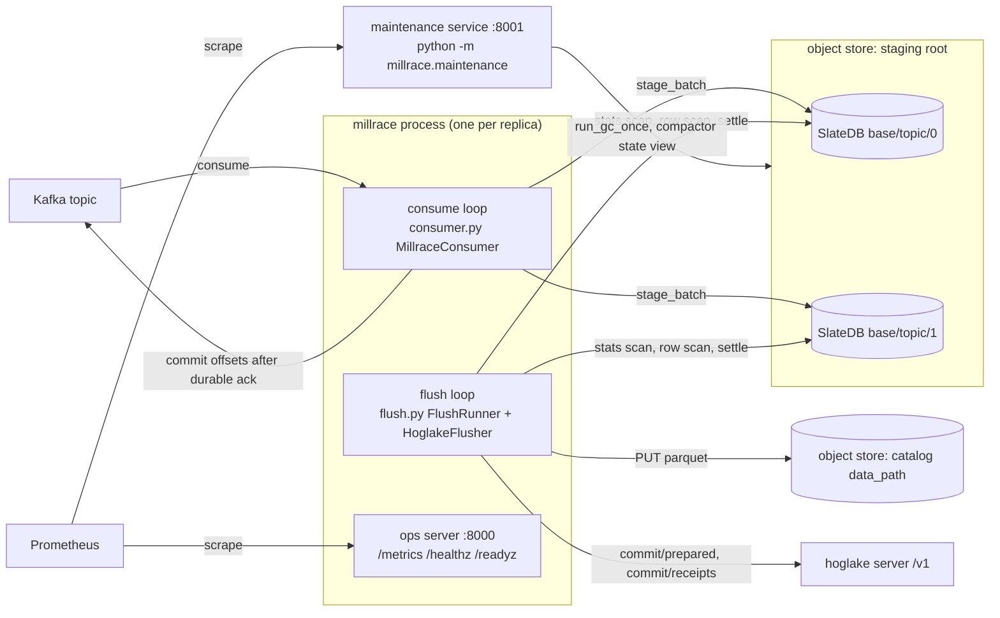
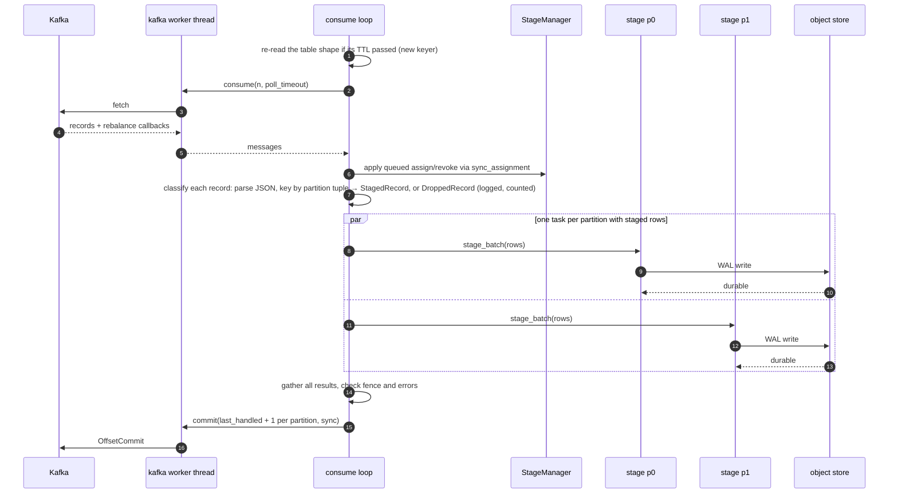
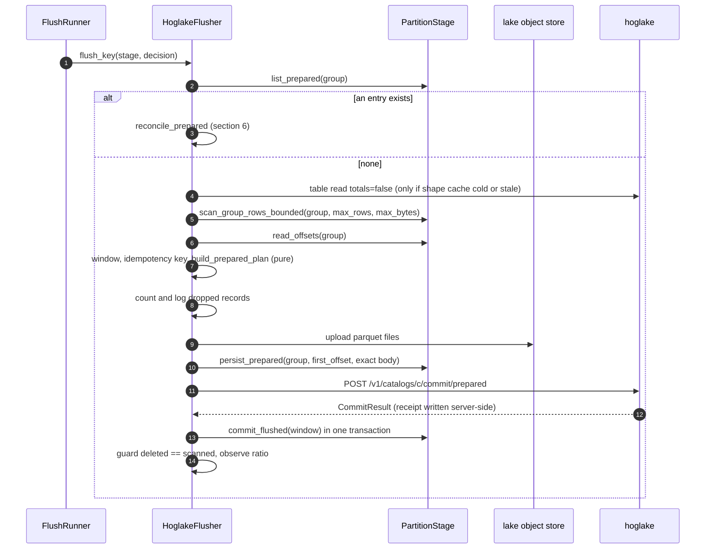
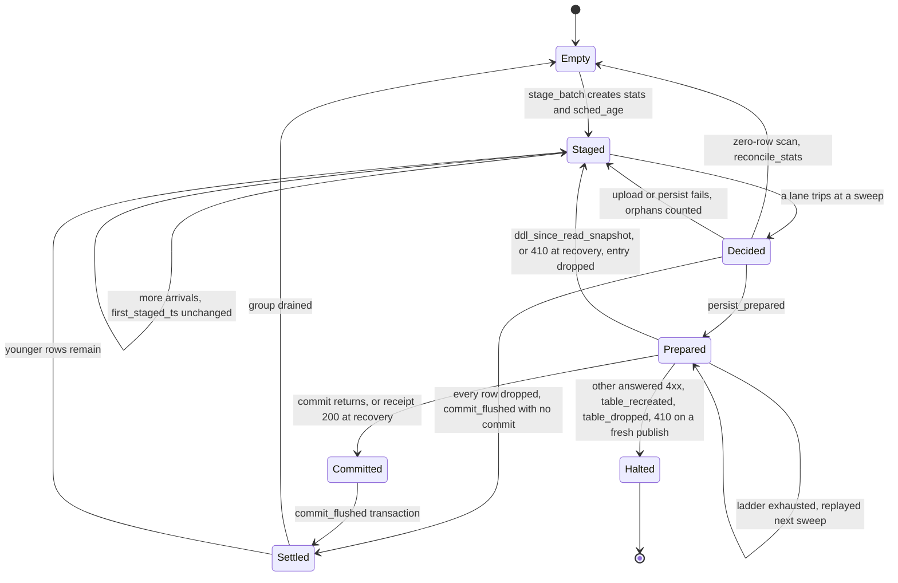

# millrace architecture

How millrace works, as built on this branch. Operator summary:
[README.md](README.md). Design rationale:
[docs/kafka-ingestion.md](../docs/kafka-ingestion.md). Code references
are `module.py:symbol` under `millrace/millrace/`; tests are under
`millrace/tests/`.

## 1. What millrace is

millrace consumes one Kafka topic and publishes its records as parquet
files committed to one hoglake table (hoglake is this repo's lakehouse
catalog server; its `/v1` commit API registers already-uploaded parquet
files as a snapshot). Between consume and publish sits a durable staging
buffer: one [SlateDB](https://slatedb.io) instance (an embedded LSM
key-value store whose WAL and SSTs live on object storage) per claimed
Kafka partition. The consume loop parses each record's value as a JSON
object, computes the destination table's **partition tuple** for it (the
`partition_values` a file of that row would carry under the table's live
partition spec), and writes the record into SlateDB keyed by
`(partition tuple, record timestamp, offset)`; it commits Kafka offsets
once the write is durable on the object store. An independent flush loop
decides per partition tuple (a *group*) when enough has accumulated
(size, age, or slow lane), reads that group's staged range, writes
parquet (one file per tuple under the live spec — exactly one in the
steady state), persists the complete commit request, publishes it, and
deletes exactly the published rows after the server's receipt.

**Delivery guarantee.** At-least-once end to end, with idempotent
publication:

- A Kafka offset is committed only after every record at or below it is
  durable in SlateDB or was dropped and counted (section 4, "Dropped
  records").
- A staged row is deleted only by the settlement of its window: after a
  commit receipt, or with no commit when the flush dropped every row of
  the window.
- Every commit carries an idempotency key derived from `(table_uuid,
  topic, partition, partition tuple, first_offset, last_offset)`, and the request
  bytes are persisted before the first send. A replay republishes the
  same bytes under the same key and the server's receipt collapses it
  into one commit. A `prepared/` entry whose receipt lookup 404s is
  replayed whatever its age. Past the server's receipt retention that
  replay is normally answered 410 (its read snapshot is below the
  expiry floor) and the window is re-prepared from the staged rows; if
  the first attempt had landed, the window lands a second time. That
  is accepted at-least-once behaviour and is counted (section 6).
- Otherwise duplicates appear only below the *settled floor*: if consumption
  restarts at an offset whose rows were already flushed and deleted
  from staging (a changed `MILLRACE_KAFKA_GROUP_ID`, offsets aged out of
  `__consumer_offsets` under `earliest`), those records stage as new rows
  and publish under new keys.

**What it is not.**

| Not | Why |
|---|---|
| An in-memory buffer | Every consumed record is either durable in SlateDB or uncommitted in Kafka; nothing accumulates in process memory across polls. |
| A withheld-offset consumer | Offsets advance at stage time, not flush time. (millpond, the predecessor, kept an in-memory buffer and withheld offsets until flush; millrace exists to break that coupling.) |
| A backpressured consumer | Nothing pauses the consumer. Staging gauges are alert inputs, never control flow. The only throttles are librdkafka's local fetch queue cap (`MILLRACE_KAFKA_QUEUED_MAX_MESSAGES_KBYTES`) and SlateDB's own write stall, which blocks the staging write itself. |
| A multi-topic or multi-table router | One process = one topic → one table. |

## 2. The shape of the system



Inside one process the consume loop and the flush loop are asyncio
tasks on one event loop sharing one
`stage.py:StageManager`. Blocking calls stay off that loop: librdkafka
calls run on one dedicated worker thread (its consumer is
single-threaded); pyhoglake calls and the parquet build run on the
flusher's thread pool, sized `4 × MILLRACE_FLUSH_CONCURRENCY`; the ops
HTTP server runs on its own daemon thread and shares no lock or loop
with the pipeline.

| Entry point | Owns | Exit codes |
|---|---|---|
| `millrace` console script (`main.py:main`; also `python -m millrace.main`) | One topic → one table: config, `StageManager` (one SlateDB per claimed partition), `MillraceConsumer`, `HoglakeFlusher` + `FlushRunner`, ops server on `MILLRACE_METRICS_PORT` (default 8000) | 0 clean stop (SIGINT/SIGTERM), 1 other failure (incl. destination resolution failure at startup), 2 invalid config or missing `HOGLAKE_URL`, 3 flush pipeline halted (`FlushHalted`), 4 consumer fenced (`ConsumerFencedError`). Fenced outranks halted outranks generic (`main.py:_exit_code_for`). |
| `python -m millrace.maintenance` (`maintenance.py:main`) | GC and L0-debt monitoring for every SlateDB under one staging root, all topics; ops server on `MILLRACE_MAINTENANCE_METRICS_PORT` (default 8001) | 0 clean stop, 1 failure, 2 invalid config |
| Ops HTTP server (`server.py:serve`, a thread inside each process) | `GET /metrics` (Prometheus exposition), `/healthz` (liveness), `/readyz` (readiness); 404 otherwise | n/a |

## 3. Data model in SlateDB

### One SlateDB per topic-partition

Each claimed `(topic, partition)` gets its own SlateDB instance at
`{stage_base_path}/{topic}/{partition}` on the store named by
`MILLRACE_STAGE_URL` (`stage.py:StageManager.path_for`). The path is
keyed by the partition, not the pod: the Kafka assignment is the claim
(opening the DB is part of claiming, closing it part of releasing), and
staged state follows the partition to its next owner with nothing
flushed or abandoned on revocation. SlateDB is single-writer per path,
matching Kafka's one owner per partition; a second open of the same path
succeeds and fences the older writer lazily (section 4). Keys carry no
partition component, and Kafka offsets are unique within an instance,
which is what lets an offset window identify rows exactly.

### Groups: the partition tuple

A *group* is one hoglake partition tuple of the destination table: per
field of the table's live `PartitionSpec`, in spec order, the wire
string a file of the tuple carries in `partition_values` (None for a
null component). An unpartitioned table has one group, the empty tuple.
Every row is staged under its group, and the group is the flush unit.
The consumer computes it per record (`grouping.py:GroupKeyer.group_for`,
section 4):

1. find each partition field's source column by `source_field_id` in the
   column tree — a struct leaf is a legal source, read by its dotted
   path (e.g. `properties.team_id`) here and by `pc.struct_field` in
   the flush's fanout. When the keyer is built it refuses
   (`GroupKeyError`): an unknown field id; a container source; a source
   under a list or map; a json source; a variant source (its column
   is refused, below); an unknown transform;
   `bucket`/`truncate` without its positive parameter; a temporal
   transform on a type pyhoglake's temporal gate refuses; `bucket` on a
   type outside pyhoglake's bucketable set (boolean, float, double,
   uint32, uint64, timestamp_s/ms/ns); `truncate` on a type outside its
   truncatable set (only the int widths, string, binary and decimal).
   Nothing that builds can then fail per record for its type;
2. read the scalar from the parsed payload by path (absent or null
   anywhere on the path → a null component);
3. coerce it with the column's coercer (`coerce.py:coercer_for`, the
   same coercion the flush decoder applies);
4. apply `pyhoglake.transforms.transform_value` and render the component
   with `transforms.wire_string` (decimals at the column's scale, with
   negative zero rendered `0.00` as Arrow stores it).

The keyer's tuple equals the tuple the flush's fanout files the same
payload under, across the full scalar type × transform matrix
(`test_grouping.py::test_the_full_type_transform_matrix_keys_like_the_fanout_or_refuses_at_build`)
and for struct-leaf sources, where a null or absent struct is a null
component on both sides
(`test_grouping.py::test_a_struct_leaf_sources_tuple_is_the_flush_fanouts_tuple`).
The group is a layout optimization, not the source of truth: the flush
still fans every window out by the table's **live** spec
(`flush.py:_partition_groups`), so a group keyed under an older spec
flushes correctly, as several files.

Any partition can hold any group, so a group spread over K Kafka
partitions flushes as up to K independent windows per readiness cycle,
and a medium group split thinly may fall under `MILLRACE_MIN_FLUSH_BYTES`
per instance and move from the age lane to the slow lane. Identity is
unaffected: topic and partition are inputs to the idempotency key.

Human form (`keyspace.py:group_label`, used in logs and the commit
message): `name=value` per field joined by `/`, e.g.
`team_id=42/timestamp_month=681`. Field names follow hoglake's display
rule (`grouping.py:field_names`, the server's `PartitionFieldLabels`):
the source's dotted path for an identity transform, `<path>_<transform>`
otherwise, `field_<id>` for an unresolvable source. Names and values are
percent-encoded (ASCII, injective); a null component renders as its bare
field name. The flusher names a staged group from the live spec for the
commit message and the `prepared/` envelope; a group whose arity differs
from the live spec's (keyed under an older spec) is named positionally,
`key_<i>`. The idempotency key does NOT use these names (below).

### Key layout

Encoding rules (`keyspace.py` module docstring): integers are fixed-width
big-endian with no separators; signed values in keys (timestamps,
offsets) use offset binary (`value + 2^63` as u64) so byte order equals
numeric order, negatives included; every value starts with a 1-byte
version and readers refuse unknown versions. The group (`<group>` below,
`keyspace.py:encode_group`) is prefix-free: `arity u8`, then per
component a 1-byte tag (`0x00` null, `0x01` present) and, when present,
`len u16` + UTF-8 bytes. The arity byte makes the whole tuple
prefix-free, so a tuple whose components are a byte prefix of another's
(`(a,)` under an older one-field spec vs `(a, b)`) never shares a key
prefix with it, and the range helpers (`group_rows_range`,
`group_prepared_range`) take the prefix successor of the full
`prefix + group` bytes. Keys parse their fixed-width timestamp/offset
fields off the end; `decode_group` refuses anything that is not exactly
one well-formed tuple.

| Prefix | Key bytes | Value | Written by | Read by | Deleted by |
|---|---|---|---|---|---|
| `rows/` | `rows/` + group + record_ts_us i64ob + offset i64ob | Raw Kafka payload bytes | `stage.py:PartitionStage.stage_batch` | `scan_group_rows_bounded`, `scan_group_rows` (flush, recovery) | Settlement transaction (`commit_flushed`) |
| `stats/` | `stats/` + group | v1, 33 B: `staged_bytes u64, first_staged_ts i64, last_staged_ts i64, row_count u64` | `stage_batch` (merge) | `iter_key_stats` (planner + gauges), `read_group_stats` (age/slow point reads) | Settlement (subtract, or delete on drain), `reconcile_stats` |
| `sched_age/` | `sched_age/` + first_staged_ts i64ob + group | empty | `stage_batch`, when the group's stats entry is created | `iter_sched_age_through` (flush sweep) | Settlement on drain, `reconcile_stats` |
| `offsets/` | `offsets/` + group | v1: count u16, then per range `topic_len u16, topic, partition u32, first i64, last i64`, sorted canonically | `stage_batch` (one span per group per batch; overlapping spans coalesced) | `read_offsets` (flush window and commit message) | Settlement clips the window out; key dropped with its last range |
| `prepared/` | `prepared/` + group + first_offset i64ob | v4: `idempotency_key, topic, partition`, the group as hoglake partition values (`arity u8`, then per field `name, tag, value?`), `body` (exact request bytes), `persisted_at u64 µs`. Only v4 decodes. | `persist_prepared` (flush, before publication) | `list_prepared` (per-group gate), `load_prepared` via `recover` | Settlement transaction, `drop_prepared` (re-prepare) |
| `flushed/` | legacy | legacy marker | nothing on this branch | nothing (not decoded) | `recover` collects leftovers in pages of 1000 |

`first_staged_ts` is set once, when a group's stats entry is created, and
never advanced by later arrivals; it is born again only after a flush
drains the group's last row. After a partial settlement it keeps the
older timestamp, which can only make the remaining rows flush earlier.

Three durable units touch these prefixes. Everything one poll stages
into one partition (rows, stats, sched, offsets) is one
`WriteBatch`, and `stage_batch` returns only after `await_durable()`, so
accounting cannot drift from data even on a hard kill. `persist_prepared`
is one durable `WriteBatch`. Settlement (`commit_flushed`) is one
`SERIALIZABLE_SNAPSHOT` transaction run only with the receipt in hand
(or with no commit at all, when the flush dropped every row of the
window), so the only ambiguous state after a crash is a
surviving `prepared/` entry. One asyncio lock per instance serializes
this process's mutations (consume and flush share the instance); reads
take no lock, and SlateDB iterators are snapshots as of creation.
Row-key order is `(group, timestamp, offset)`, so no byte range narrower
than the group's slice isolates an offset window: settlement scans the
group's whole slice and deletes the keys whose offset lies in
`[first_offset, last_offset]` (`keyspace.py:row_in_flushed_range`); other
rows of the group survive. The settlement window type
(`keyspace.py:FlushedKey`) carries the group as hoglake partition values
(field names beside wire strings).

### Idempotency key

`keyspace.py:idempotency_key` = UUIDv5 over namespace
`70cd616a-eaef-5359-838c-573cb224e4f9` of
`millrace:v2:table=<uuid>:topic=<topic>:partition=<n>:group=<k0=…/k1=…>:offsets=<first>-<last>`,
the group rendered by `keyspace.py:group_key_form`: the tuple's wire
strings under POSITIONAL names `k<i>` (percent-encoded, a null as a bare
`k<i>`, empty for an unpartitioned table), e.g.
`…:group=k0=42/k1=681:offsets=0-41`. The key is a pure function of the
staged tuple: a spec change between an upload and a rebuild of the same
window — even one of the same arity, which would rename the display
fields — cannot change the key.

| Input | Why |
|---|---|
| `table_uuid` (canonicalized) | Receipts survive a drop; a recreated table must not answer from its predecessor's receipt. |
| `topic`, `partition` | Offsets are per partition. Without them two partitions flushing one group over the same offset range would share a key and object URIs. |
| group (positional form), `first_offset`, `last_offset` | The flushed window. Both ends, because "up to N" is not a row set after a rewind. |

Parquet object names are
`{data_path}/data/{namespace}/{table}/{idempotency_key}/{build}/{index}.parquet`,
where `build` is a fresh uuid4 hex minted per build
(`HoglakeFlusher.flush_key` → `FlushContext.build`; the builder stays
pure). A verbatim replay sends the persisted bytes and names the
persisted objects; a rebuild of the same window keeps the key and
mints new object names, so it never overwrites an earlier build's
objects (which a landed commit may reference).

## 4. The consume loop

`consumer.py:MillraceConsumer._step` runs one poll cycle until stopped.



0. **Refresh the keyer** when its TTL has passed (below, "The keyer").
1. **Size the poll.** `n = MILLRACE_CONSUME_BATCH_SIZE`, clamped to
   `MILLRACE_CONSUME_BATCH_MAX_BYTES ÷ observed mean record size` (key +
   value bytes, cumulative over the run), floored at 1; the first poll
   uses the record cap alone. Poll on the worker thread with
   `MILLRACE_POLL_TIMEOUT_MS`.
2. **Apply assignment events** queued by the rebalance callbacks by
   syncing to `consumer.assignment()` (`_apply_assignment_events`). This
   precedes staging, so a partition revoked mid-poll is closed first and
   its fetched records are skipped; the new owner replays them.
3. **Classify** each record (`classify_message`): parse the value once
   as a strict JSON object (`coerce.py:load_json_object`) and stage it
   under the keyer's partition tuple; anything else is dropped (below).
   The Kafka message key is never read for staging. Error events and
   records without coordinates are counted and skipped, never committed
   past explicitly.
4. **Stage concurrently**: one `stage_batch` task per partition with
   staged rows,
   `asyncio.gather(return_exceptions=True)`, so every partition's WAL
   write and durability wait overlap and every batch settles before any
   outcome is examined.
5. **Commit** once, synchronously, for all touched partitions at
   `last_handled + 1` (handled = staged or dropped; a partition whose
   poll was all drops commits with no `stage_batch`), only if every
   batch succeeded. Retry ladder: 3 attempts, 0.5 s then 1.0 s;
   exhaustion raises (offsets unadvanced, restart replays).

### The keyer

`consumer.py:MillraceConsumer` holds a `grouping.py:GroupKeyer` built
from the destination's shape. At startup (`main.py:_run`) it is built
from the `TableInfo` the flusher resolved
(`HoglakeFlusher.resolved_info`), so the consumer sees the same table
and the same pinned `table_uuid`; a spec the keyer cannot key fails
startup (exit 1). The consumer then re-reads the shape on the flusher's
TTL — a quarter of the catalog's snapshot retention, 450 s when the
catalog reports none (`flush.py:retention_ttl_s`) — on its own schedule:
before a poll, once the TTL has passed, through
`flush.py:ShapeReader` (its own `Table` handle, a `totals=false` read
pinned to the flusher's incarnation, run on the default executor). A
successful read swaps in a fresh keyer; a transient failure (transport,
an answered error) or a shape the keyer refuses logs a warning and keeps
the old keyer until the next TTL. A read that names a different
`table_uuid` (`FlushHalted("table_recreated")`) or lacks
`read_snapshot_id` (`FlushHalted("server_capability")`) is not transient:
it propagates out of the consume loop before the poll, so nothing more
is staged or committed, and the process exits 3. A stale keyer only groups under an older
spec: the flush's fanout by the live spec keeps files correct. A spec
change therefore just starts new groups; groups keyed under the old
spec drain by the age or slow lane, each flushing as several files.

The flusher's own startup check (`HoglakeFlusher.resolve`,
`FlushStartupError`, exit 1) refuses by column only what the decoder
cannot fill — an unknown type, a `variant` (at any depth; see "Not yet
built"), a malformed container, a map whose key child is a container or
`json` (a JSON object key is a string, which no such key coerces),
nesting past 8 — and by spec a
partition or sort source that is not one scalar per row: a container, a
json column, or a leaf under a list or a map
(`flush.py:_source_fault`; a struct leaf is accepted).

librdkafka config (`kafka_consumer_config`): `enable.auto.commit=false`,
`enable.auto.offset.store=false`, `auto.offset.reset` from config,
fetch knobs from config; cooperative mode adds
`partition.assignment.strategy=cooperative-sticky`.

### Assignment

`StageManager.sync_assignment(claimed)` closes partitions no longer
claimed (clean SlateDB shutdown; nothing flushed or deleted), then opens
newly claimed ones, always running `PartitionStage.recover()`
(section 6).

| Mode | Claim | Order |
|---|---|---|
| `static` (default) | `MILLRACE_KAFKA_PARTITIONS`; `assign()` with `OFFSET_STORED` | Stages are opened and recovered before `assign()`. A coordinator warmup probe (`committed()` up to 24 attempts, 0.5 s apart, 5 s timeout each) runs first, because librdkafka resolves `OFFSET_STORED` once and never retries; exhaustion fails startup. |
| `cooperative` | `subscribe()` with `on_assign` / `on_revoke` / `on_lost` | Callbacks fire on the worker thread inside `consume()` and only enqueue; the loop applies them after the poll. `lost` is handled like `revoke`. |

### FENCED halt

SlateDB fences lazily: a newer writer's open of the same path succeeds,
and the older writer gets `Error.Closed(reason=FENCED)` at its next write's
durability wait (`tests/test_slatedb_parity.py::test_writer_fencing_on_contested_open_memory`, `..._file`).
Under static assignment no rebalance event warns the old owner; a
one-at-a-time StatefulSet rollout runs old and new pods for one ordinal
at once.

| Where detected | Action |
|---|---|
| Consume: a `stage_batch` raises `Closed(FENCED)` | Close the fenced stages locally, raise `ConsumerFencedError` naming them. The failed batch's offsets are not committed. `/healthz` and `/readyz` 503 from that moment; the process exits 4, distinct from a crash because a restart onto the same assignment reopens the path, fences the new owner, and leaves two pods fencing each other with offsets never advancing. Any other `Closed` reason takes the generic error path. |
| Flush: any `SlateError.Closed` at recovery, planning or mid-decision | `FlushRunner._note_fenced`: the partition leaves flush scheduling, logged once, listed in `fenced_partitions` and `millrace_flush_partition_fenced`; `/healthz` 503s. The mark clears when the assignment revokes the partition. This is how an idle partition's fence surfaces. |

### Dropped records

A record that can never become a row is dropped: nothing is written for
it, and the offset commit covers it trivially. `classify_message`
returns `stage.py:DroppedRecord(offset, reason)`; `_note_drop` counts it
in `millrace_records_dropped_total{reason}` and logs it at WARNING with
topic, partition, offset and the full reason, at most one line per
(partition, reason) per `consumer.py:DROP_LOG_INTERVAL_S` (10 s) of the
monotonic clock — the first drop of a reason always logs, a later line
carries the count suppressed since the last one.

| Reason (log) | Label | Cause |
|---|---|---|
| `invalid_offset` | same | Offset < 0 or > int64 max |
| `missing_timestamp` / `invalid_timestamp` | same | `TIMESTAMP_NOT_AVAILABLE`, or ms × 1000 overflows int64 |
| `missing_value` | same | Tombstone |
| `malformed_value` | same | The value is not a strict JSON object (not JSON, not an object, NaN/Infinity literals) |
| `malformed_partition_source:<path>` | `malformed_partition_source` | A partition source scalar is the wrong JSON type, fails its column's coercion, cannot take the transform (e.g. an instant outside Python's datetime range), sits under a non-object parent, or renders past 65,535 bytes; `<path>` is the source's dotted path, kept out of the label (`consumer.py:drop_reason_label`). An absent or null source is a null component, not a drop. |

The flush drops records too (section 5, step 6); those share the
counter under their own reasons. The count is per classification: a
poll whose batch fails and replays counts its drops again.

### `auto.offset.reset`

`MILLRACE_KAFKA_AUTO_OFFSET_RESET` applies only to a partition with no
committed offset. Default `latest` (the fleet policy after a
whole-retention replay incident): a partition whose offsets were lost
(changed group id, offsets aged out) starts at the head and its backlog
is never consumed. `earliest` replays all of retention, and anything
below the settled floor publishes twice. The levers are group-id
stability and `offsets.retention.minutes` outliving any dark period;
with both, the knob only affects genuinely new partitions.

## 5. The flush loop and the three-lane planner

`flush.py:FlushRunner.run` calls `run_once` and sleeps
`MILLRACE_FLUSH_SWEEP_S` (default 5 s) between ticks.

### One sweep

Per open, non-fenced partition, in sorted order:

1. **Reconcile** (first tick after a claim only): `recover()`, then
   `HoglakeFlusher.reconcile_prepared` for every surviving `prepared/`
   entry (section 6). A transient failure skips the partition this tick
   (its gauges are still published) and retries next tick; `FlushHalted`
   stops the runner; `SlateError.Closed` fences the partition.
2. **Assemble stats** (`_assemble_stats`): one full `stats/` scan (the
   size lane's input and the gauge source), then a `sched_age/` scan
   through `now − MILLRACE_FLUSH_DEADLINE_S` with a point read of each
   candidate's `stats/` entry replacing the scan's older snapshot. A
   `sched_age/` entry without `stats/` raises `StageCorruptionError`.
3. **Plan**: `planner.py:plan_flush(stats, now, knobs,
   estimated_compression_ratio=flusher.compression_ratio)`; record the
   partition's gauges and oldest eligible `first_staged_ts`; queue its
   decisions.

Then publish the pod's gauges (`StageManager.publish_gauges`) and execute
the queue (`_execute`): at most `MILLRACE_FLUSH_CONCURRENCY` (default 4)
decisions in flight per partition (semaphores) and a worker pool of
`min(len(work), 4 × concurrency)` process-wide; dispatch follows planner
order within a partition; `concurrency = 1` is one worker, strictly
serial. A failed decision (ladder exhausted, encoder bug, object-store
fault) is logged and counted; the rows stay staged and the next sweep
retries. `StageClosedError` (revoked mid-sweep) drops the partition's
remaining decisions. `SlateError.Closed` fences the partition.
`FlushHalted` is sticky: workers stop pulling, in-flight decisions
finish, and every later `run_once` re-raises the halt.

### The planner

`planner.py` is pure: no I/O, no clock reads. Per group (one
`planner.py:KeyStats` per `stats/` entry), the default
`ThreeLanePolicy.decide` checks in this order and takes the first match:

| Order | Lane | Condition | Catches |
|---|---|---|---|
| 1 | `size` | `staged_bytes × ratio ≥ MILLRACE_TARGET_OUTPUT_BYTES` | Large groups: full-size files early |
| 2 | `slow` | `age ≥ MILLRACE_SLOW_LANE_DEADLINE_S`, any size | Tiny or churned groups (and groups keyed under a retired spec); the only lane that takes a group below `min_flush_bytes` |
| 3 | `age` | `age ≥ MILLRACE_FLUSH_DEADLINE_S` and `staged_bytes ≥ MILLRACE_MIN_FLUSH_BYTES` | Medium groups: the freshness SLA |

`age = now_us − first_staged_ts`; negative ages (clock skew) trip no
deadline, and because slow outranks age an age-lane decision's age lies
in `[flush_deadline, slow_lane_deadline)`. `ratio` (parquet bytes ÷
staged bytes, validated `0 < ratio ≤ 1` on every call) is
`flush.py:CompressionRatioEwma`: `DEFAULT_COMPRESSION_RATIO = 0.2` until
the first committed flush, then an EWMA with halflife
`MILLRACE_COMPRESSION_RATIO_HALFLIFE` (default 20 flushes), in memory
only, reset when the table's shape fingerprint (uuid, columns, partition
spec, sort spec) changes; replays are not observed and observations
above 1 clamp to 1. Output is ordered by `first_staged_ts`, ties broken
by the group's key bytes (`keyspace.encode_group`); a duplicate group in
the snapshot is refused. At defaults the size lane
fires at 2,500 MiB staged (500 MiB ÷ 0.2), the age lane at 900 s with
≥ 1 MiB staged, the slow lane at 21,600 s. The decided set is exactly
the eligible set; its minimum `first_staged_ts` drives
`millrace_oldest_eligible_staged_age_seconds` (section 9).

### One flush (`HoglakeFlusher.flush_key`)



1. **Outstanding-entry gate.** Any `prepared/` entry for the group is
   reconciled and the call returns; no new window is built while one
   stands. The lookup is per group, not keyed by the scan's first offset.
2. **Shape and basis first.** `_shape_sync` returns the cached
   `TableInfo` or re-reads it with `totals=false`; its `read_snapshot_id`
   is the commit's `read_snapshot`, pinned before the staged range is
   read. Cache TTL is a quarter of the catalog's snapshot retention
   (`_retention_ttl_s`; 450 s if the catalog reports none). A re-read
   whose `table_uuid` differs from the pinned one halts
   `table_recreated`; one without `read_snapshot_id` halts
   `server_capability`. The group's field names come from this shape
   (`flush.py:_group_fields`; positional `key_<i>` when the group's
   arity is not the live spec's).
3. **Bounded scan.** Byte budget
   `max(MILLRACE_FLUSH_SCAN_MIN_BYTES, ceil(target ÷ ratio × 1.25))`
   (3,276,800,000 B = 3,125 MiB at defaults and ratio 0.2); row budget
   `MILLRACE_FLUSH_SCAN_MAX_ROWS`. A first row larger than the budget is
   flushed alone via a one-row probe. A zero-row scan is redelivery
   residue: `reconcile_stats` removes the stale `stats/` and
   `sched_age/` entries in a serializable transaction; outcome `empty`.
4. **Window.** Untruncated scan (the steady state): `[min, max]` of the
   scanned offsets. Truncated scan: `_covered_window` narrows to the
   longest prefix whose `offsets/` spans the scan fully covers (record
   timestamps are not offset-monotone); rows past it stay staged. The
   message's offset ranges are the `offsets/` record clipped to the
   window.
5. **Build** (`build_prepared_plan`, pure, on the I/O pool): decode each
   payload as a JSON object against the table's columns
   (`JsonObjectDecoder`, the per-column coercers of
   `coerce.py:coercer_for`; undecodable or uncastable records are
   dropped — `undecodable_payload` / `uncastable_column` — unknown
   top-level keys dropped from the row and logged once per key, unknown
   keys inside a struct ignored). Column types, by coercer:

   | Catalog type | JSON value | Lands as |
   |---|---|---|
   | scalars | the scalar's JSON form (`coerce.py` module docstring) | the scalar |
   | `struct` | object | one value per catalog child; absent or null child → NULL; keys the catalog does not name ignored |
   | `list` | array | coerced elements |
   | `map` | object | `(key, value)` pairs in object order; the key STRING goes through the key child's coercer as-is, then (for a non-string key child) parsed as a strict JSON number/boolean (`"42"` → `long` 42). The string form wins: a temporal key that is valid ISO text is read as such (`"20260101"` is a `date` 2026-01-01, never an epoch day); the numeric fallback applies only to non-ISO strings. Two keys coercing to one STORED value (a `float` key compared after float32 narrowing) → `uncastable_column`. A container or `json` key child is refused at startup |
   | `json` | any | canonical text, `json.dumps(v, separators=(",", ":"), ensure_ascii=False, allow_nan=False)`, in the `pa.json_()` string storage |
   | `variant` | — | refused at startup (`UnsupportedColumnError` naming the column; "Not yet built") |

   A top-level JSON `null` (or an absent key) is SQL NULL for every
   type, json included; inside a container a `null` is SQL
   NULL too. Either is refused (`uncastable_column`) where the catalog
   says the column or child is not nullable. A non-object/non-array
   where a container expects one is `uncastable_column`. Every decode
   failure carries the dotted catalog path of the refusing column or
   child (`DecodeError.path`, e.g. `properties.inner.id`, `attrs.key`),
   which the drop log names (step 6). Nesting is bounded by
   pyhoglake's `MAX_COLUMN_NESTING_DEPTH` (8). Apply the junk
   `event_time` window `[now − MILLRACE_EVENT_TIME_MAX_PAST_S, now +
   MILLRACE_EVENT_TIME_MAX_FUTURE_S]` to the decoded values of the
   partition spec's temporal sources (`year`/`month`/`day`/`hour`; a
   struct leaf is read and clamped by path): `drop` (default) drops the
   record (`event_time_out_of_window`), `clamp` rewrites the decoded
   value to the window edge, staged rows are never mutated. Arrow build
   (`_build_batch_isolating`): each column is built with `pa.array` at
   `flush.py:_build_type` (uuid as its 16-byte storage, json as string,
   timestamptz as naive micros, at any depth) and cast once to the
   catalog type. The one record that still defeats the build is
   isolated and dropped (`uncastable_column`) so it cannot fail the
   batch. Sort by the table's live sort spec (staging
   order is Kafka record time, the sort spec is payload time; a
   struct-leaf key is read by `pc.struct_field` into a shadow table);
   fan out by the live partition spec (a struct-leaf source likewise),
   one file per tuple (exactly one when the staged group was keyed
   under the live spec and no temporal source was clamped), halting
   `fanout_exceeds_commit_bound` above `MILLRACE_MAX_FILES_PER_COMMIT`
   before any I/O; format the commit message; per file, write parquet
   (`timestamp_s` stored as milliseconds at any depth); check
   schema/field ids at every level (a map's entries struct compared
   under Arrow's default name, `flush.py:file_schema`), and register `path, record_count, file_size_bytes,
   footer_size`, `partition_values` if partitioned, and `column_stats`
   (pyhoglake's `extract_column_stats`: leaves only, nested leaves
   included, nothing for a container) only when the
   realized file is ≥ `max(1, int(target × 0.5))` bytes (262,144,000 B
   at default; smaller files register without stats and the server's
   hydrator backfills).
6. **Drops.** The plan's dropped records are counted in
   `millrace_records_dropped_total{reason}` and logged, one WARNING per
   reason per decision naming the group, the offsets (the first 20)
   and, for a decode failure, the first refusing column's dotted path
   (`first_path=properties.inner.id (offset 7)` — catalog names only,
   never a payload value; the flush-side counterpart of the consumer's
   `malformed_partition_source:<path>`).
   Nothing is written for them: they stay staged until the window's
   settlement deletes them with the published rows. The count is per
   build, so at-least-once: a decision rebuilt after an upload or
   persist failure, or re-prepared after `ddl_since_read_snapshot`,
   counts and logs the same drops again (as the consume side does for
   a replayed poll). If every row was
   dropped there is no payload: the window settles via `commit_flushed`
   with no commit (outcome `dropped`).
7. **Upload, then persist, then publish.** Upload failure counts the
   completed URIs as orphans and re-raises (contained); persist failure
   counts the whole fanout. The persisted body is
   `canonical_body(payload)`: compact JSON identical to what httpx sends.
   `_publish` applies the ladders and refusal taxonomy below.
8. **Settle** with `commit_flushed(window)`, then `_guard_settlement`:
   rows deleted must equal rows scanned, else halt
   `settlement_mismatch`. Feed the realized ratio to the EWMA.

The request body:

```json
{"idempotency_key": "<uuidv5>", "read_snapshot": 123,
 "appends": [{"namespace": "<ns>", "table": "<table>",
              "expected_table_uuid": "<pinned uuid>",
              "files": [{"path": "...", "record_count": 0, "file_size_bytes": 0,
                         "footer_size": 0, "partition_values": ["..."],
                         "column_stats": ["..."]}]}],
 "author": "millrace/<topic>/<partition>",
 "message": "<line 1 summary>\n<line 2 offsets>"}
```

The message has no wall-clock or per-attempt content: line 1 is
`millrace=v1 table=<uuid> group=<human form> trigger=<lane> records=…
dropped=… files=… partitions=… staged_bytes=… arrow_bytes=…
millrace=<version>`,
line 2 is `offsets topic=<t> partition=<p> ranges=a-b,c-d` (above 16,384
bytes it keeps the first and last ranges and elides the middle).
Recovery parses the window back out of line 2
(`parse_message_offsets`).

### Key lifecycle



### Refusal taxonomy

Two rules are kept distinct in code. An **ambiguous** failure (lost
response, 5xx, transport error) resends the identical persisted bytes.
An **answered** refusal means the server judged the payload and wrote
nothing: the payload is never resent.

| Response | Classified as | Action | Test |
|---|---|---|---|
| 409 `commit_conflict` | retryable | Drop shape cache, resend identical bytes; up to 5 attempts, delay `min(0.5 × 2^(n−1), 30)` s; then `FlushPublishExhausted`, entry kept | `test_commit_conflict_retries_the_identical_request`, `test_commit_conflict_exhaustion_keeps_the_prepared_entry` |
| 409 `table_dropped` (same exception class) | halt | `FlushHalted("table_dropped")` | `test_table_dropped_409_halts` |
| 409 `ddl_since_read_snapshot` | re-prepare | Count orphans (fresh publish) or unresolved uploads (recovered entry's replay, section 6), `drop_prepared`, outcome `reprepare` (`millrace_prepared_reprepared_total{reason="ddl_since_read_snapshot"}`); rows re-decide next sweep against a fresh read, same key, fresh object names | `test_ddl_since_read_snapshot_rebuilds_never_replays`, `test_a_ddl_refusal_at_reconcile_counts_unresolved_not_orphaned` |
| 409 `table_recreated` | halt | `FlushHalted("table_recreated")`, staged state kept | `test_table_recreated_halts_loudly_and_keeps_state` |
| 410 read snapshot expired, fresh publish (`flush_key`) | halt | `FlushHalted("read_snapshot_expired")` with the server's reconcile detail; uploads orphan-accounted | `test_410_halts_with_the_servers_reconcile_instructions` |
| 410 read snapshot expired, recovered entry's replay (`reconcile_prepared`) | re-prepare | Uploads counted unresolved, not orphaned (section 6); `drop_prepared`, outcome `reprepare` (`millrace_prepared_reprepared_total{reason="read_snapshot_expired"}`); rows re-decide next sweep against a fresh read | `test_a_410_at_reconcile_reprepares_and_never_halts`, `test_the_runner_reprepares_an_aged_survivor_on_410_without_halting` |
| 404 destination | halt | `FlushHalted("destination_missing")` | — |
| 422 `idempotency_key reused` | halt | `FlushHalted("idempotency_key_reused")`: foreign writer or broken determinism | `test_422_reused_idempotency_key_halts` |
| Any other answered 4xx (400, 401, 403, 413, any other 422 — request-shape `validation` or `record_validation`) except 408/429 | halt | `FlushHalted("commit_refused")`, rows and `prepared/` entry kept; no answered refusal deletes staged rows | `test_422_request_shape_halts_with_rows_staged`, `test_422_record_validation_halts_with_rows_staged`, `test_answered_4xx_halts_with_rows_staged` |
| 503 `commit_queue_timeout`, other 5xx, 408, 429 | ambiguous | Resend identical bytes; up to 8 attempts, delay `max(min(0.5 × 2^(n−1), 30), Retry-After)`; then `FlushPublishExhausted`, entry kept | `test_503_commit_queue_timeout_backs_off_per_retry_after` |
| Transport error (httpx/OSError) | ambiguous | Same as 5xx | `test_dropped_commit_response_replays_persisted_bytes_in_process` |

`Retry-After` is captured from 429/503 responses by an httpx response
hook (delta-seconds only) and consumed once. Every halt with uploaded objects counts and names them in
`millrace_flush_orphaned_uploads_total` and the log. All tests in
this table are in `tests/test_flush.py`.

## 6. Recovery and exactly what happens on restart

### Two checkpoints

As in hedgerow (the repo's other buffered ingester, with a SQLite WAL
instead of SlateDB), the *consume* and *publication* checkpoints are
separate and never wait on each other.

| Checkpoint | Where | Advances when |
|---|---|---|
| Consume | Kafka committed offset per partition | Every record at or below it is durable in SlateDB or was dropped and counted |
| Publication | Per-group `prepared/` entry, then its removal in the settle transaction | Entry written after upload and before the first send; removed atomically with the published rows after the receipt |

### On open: `PartitionStage.recover`

Run by `StageManager.open_partition` for every claim and again by the
flush runner's first tick for that partition; idempotent. It deletes any
legacy `flushed/` markers (1000 keys per durable batch, lock taken per
page, nothing decoded) and returns every `prepared/` entry: the complete
ambiguity set.

### Per surviving entry: `HoglakeFlusher.reconcile_prepared`

1. Parse the body. Refuse as `StageCorruptionError` if it is not JSON,
   its `idempotency_key` differs from the envelope's, the envelope names
   another `(topic, partition)` or another partition tuple than its
   `prepared/` key, the message is missing or has no
   parseable offsets line naming this stage, or the parsed
   `first_offset` differs from the key's. A refused entry is left in
   place: the runner logs it and retries it every tick until an operator
   removes it.
2. Scan the group's rows in the parsed window (the settle guard's count).
3. `GET /v1/catalogs/{catalog}/commit/receipts/{idempotency_key}`.
   - **200**: settle locally with `commit_flushed`, zero republication,
     regardless of the entry's age. Outcome `receipt_settled`.
   - **404**: `_publish` the persisted payload verbatim, same key,
     regardless of the entry's age; the entry's age
     (`now − persisted_at`) is logged. Accepted → settle, outcome
     `replayed`, counted in `millrace_prepared_replays_total`. Answered
     410 → re-prepare (below). Other answered refusals follow the
     taxonomy above.

The entry is authoritative for its own window, which may be a strict
prefix of what is now staged; the remainder is decided on a later sweep.
The same path runs whenever `flush_key` finds an outstanding entry, so a
ladder-exhausted publish is resolved receipt-first on the next sweep.

**Past the receipt retention.** The server purges receipts after
`min(max(HOGLAKE_RECEIPT_RETENTION_SECONDS, 2 × snapshot retention), 30 d)`
(the knob defaults to 7 d). A 404 for an entry older than that is
ambiguous between "never landed" and "landed, receipt purged".
`persisted_at` gates nothing; what happens is:

1. The verbatim replay is sent. With snapshot retention ≤ 30 d the
   request's `read_snapshot` (older than the first landing) is below
   the expiry floor by the time the receipt is purged, so the server
   answers 410.
2. 410 at reconcile (`reconcile_prepared`; a `ddl_since_read_snapshot`
   there is handled identically under its own reason): the dropped entry's objects
   are logged at WARNING ("may be live … or orphaned; reconcile against
   the catalog before deleting", with the entry's age and key) and
   counted in `millrace_flush_unresolved_uploads_total`, not
   `millrace_flush_orphaned_uploads_total`; the entry is dropped
   (`drop_prepared`); `millrace_prepared_reprepared_total{reason="read_snapshot_expired"}`
   increments; outcome `reprepare`; no halt. `_publish` already dropped
   the shape cache.
3. A later sweep plans the still-staged rows like any others and
   rebuilds against a fresh read. An unchanged window keeps the
   idempotency key; the build mints fresh object names, so the first
   attempt's objects are never touched. If the first attempt landed,
   the window now exists twice — two file-row sets over two object
   sets, exact duplicate rows — and the first attempt's objects are the
   unresolved uploads from step 2. An abandoned rebuild's objects are
   orphans, accounted as usual. A rebuild whose own publish is lost and
   whose read snapshot then expires goes through this step again, and
   each such cycle leaves another unresolved object set behind. The rebuild applies the junk
   `event_time` window against the current clock: under `drop`, an
   entry older than `MILLRACE_EVENT_TIME_MAX_PAST_S` can rebuild with
   every row dropped and settle with no commit.
4. With snapshot retention off, above 30 d, a consumer-floor pin, or
   an expiry sweep that has not yet advanced the floor, the verbatim
   replay itself executes: a second set of file rows over
   the same objects, counted in `millrace_prepared_replays_total`. If
   the first landing was compacted and expired meanwhile, its paths sit
   in the removal queue and the replay is refused 409 `CommitConflict`,
   retried, then `FlushPublishExhausted` each sweep until the queue
   drains.

### Failure → outcome

| Failure point | State left | On restart / next sweep |
|---|---|---|
| Before `stage_batch` is durable | Nothing committed in Kafka | Records re-consumed from last commit and re-staged; row keys are derived from the record, so re-puts are idempotent |
| After durable stage, before offset commit | Rows staged, offset behind | Same records re-put in place; `stats/` counters inflate (settle subtracts actuals; residue is removed by `reconcile_stats` when the group scans empty) |
| After upload, before `persist_prepared` | Objects in lake, no entry | Orphans are counted only when the persist failed in-process; a crash leaves them uncounted and unnamed. Next sweep rebuilds the window: same key if the window is unchanged, fresh object names |
| After persist, before commit landed | `prepared/` entry | Receipt 404 → verbatim replay, any age |
| Commit landed, response lost or crash before settle | `prepared/` entry, server receipt | Receipt 200 → local settle, zero republication |
| Publish ladder exhausted | `prepared/` entry | Next sweep reconciles receipt-first |
| Commit landed, entry outlived the server's receipt retention | `prepared/` entry, receipt purged | Receipt 404 → verbatim replay → 410 → entry dropped, objects counted unresolved, rows re-prepared next sweep; the window lands twice (counted). Without a snapshot floor the replay itself lands twice |
| Partition reassigned to another pod | DB at the partition's path | New owner opens it, `recover()` returns the entries, first sweep reconciles them |
| Contested open (rollout overlap) | Two writers on one path | Old writer fenced: consumer exits 4, flush fences the partition out |
| Table dropped and recreated | Pinned uuid stale | Halt `table_recreated` at the next shape refresh or commit |

## 7. Maintenance service

`maintenance.py` runs as its own process beside a millrace deployment and
covers every per-partition SlateDB under one staging root, across topics
and replicas, so replicas do not spend network and CPU on LSM
collection. Per sweep:

1. **Discover** DBs by listing the staging root (pyarrow S3 listing for
   `s3://`, `os.walk` for `file:///`; `memory:///` is not listable): any
   `{base}/{topic}/{partition}/manifest/*.manifest` with a valid topic
   name and an integer partition. The listing runs at most once per
   `MILLRACE_MAINTENANCE_DISCOVERY_INTERVAL_S`; sweeps in between use the
   cached set. A failed listing falls back to a warm cache (counted) or
   fails the iteration on a cold one.
2. **Budget**: the next page of at most `MILLRACE_MAINTENANCE_MAX_DBS_PER_SWEEP`
   DBs from the sorted set, rotating so every DB is visited once per
   `⌈N ÷ budget⌉` sweeps; a truncated sweep sets
   `millrace_maintenance_sweep_truncated`.
3. Per DB: `read_manifest` probe (None = vanished, skipped); read the
   compactor state view and record its L0 SST count; if GC is enabled,
   `Admin.run_gc_once` with every directory task at `min_age_ms =
   MILLRACE_MAINTENANCE_GC_MIN_AGE_MS`, no dry run, boundary files left
   enabled. Per-DB failures are logged, counted and contained.
4. Sleep `MILLRACE_MAINTENANCE_GC_INTERVAL_S × (1 ± MILLRACE_MAINTENANCE_JITTER)`.

**It does not compact.** The slatedb 0.17 Python binding has no
compactor runner: `Admin.submit_compaction` only enqueues work for the
writer's own embedded compactor (and fails against a writer whose
compactor is disabled), and a writer with `compactor_options` disabled
stalls memtable→L0 flushes at `l0_max_ssts`. So every writer keeps its
embedded compactor (there is no knob to disable it) and the service only
measures compaction debt. Writers shed their embedded GC by default
(`MILLRACE_SLATEDB_GC_ENABLED=false`) and log a boot warning that this
assumes the service is running; GC is idempotent and overlap-safe, so
double GC is wasted traffic, not corruption (section 11, item 30, and
`tests/test_slatedb_parity.py::test_submit_compaction_requires_a_running_compactor`).

**Probes:** `/readyz` 503 until one sweep has completed; `/healthz`
always 200.

Maintenance knobs (`maintenance.py:load_maintenance_config`, separate
from the pipeline's `config.py`):

| Variable | Default | Validation | Meaning |
|---|---|---|---|
| `MILLRACE_MAINTENANCE_STAGE_URL` | required | `s3://bucket/prefix`, `file:///path`, `memory:///` | Must equal the writers' `MILLRACE_STAGE_URL` |
| `MILLRACE_MAINTENANCE_GC_ENABLED` | `true` | boolean | Run GC; `false` keeps debt monitoring only |
| `MILLRACE_MAINTENANCE_GC_INTERVAL_S` | 600.0 | > 0 | Base pause between sweeps |
| `MILLRACE_MAINTENANCE_GC_MIN_AGE_MS` | 300000 | ≥ 0 | GC `min_age_ms` for every directory |
| `MILLRACE_MAINTENANCE_MAX_DBS_PER_SWEEP` | 100 | ≥ 1 | Sweep budget |
| `MILLRACE_MAINTENANCE_JITTER` | 0.2 | [0, 1) | Sweep interval jitter fraction |
| `MILLRACE_MAINTENANCE_METRICS_PORT` | 8001 | 0–65535 | Ops server port |
| `MILLRACE_MAINTENANCE_DISCOVERY_INTERVAL_S` | 3600.0 | > 0 | Minimum time between full listings |

## 8. Configuration

All pipeline knobs are read by `config.py:load_config`, which reports
every problem in one `ConfigError` (exit 2). Unless noted, numeric knobs
must be positive integers (0 is refused). An empty value means the
default.

| Variable | Default | Validation | Meaning |
|---|---|---|---|
| `MILLRACE_KAFKA_BOOTSTRAP_SERVERS` | required | non-empty | librdkafka `bootstrap.servers` |
| `MILLRACE_KAFKA_TOPIC` | required | `[a-zA-Z0-9._-]{1,249}` | The one consumed topic |
| `MILLRACE_KAFKA_GROUP_ID` | `millrace-{topic}` | — | Offset-storage group; changing it loses committed offsets |
| `MILLRACE_KAFKA_ASSIGNMENT` | `static` | `static` \| `cooperative` | Explicit `assign()` or cooperative-sticky group membership |
| `MILLRACE_KAFKA_PARTITIONS` | required iff static | comma list of unique non-negative ints; forbidden under `cooperative` | Partitions this replica claims |
| `MILLRACE_KAFKA_AUTO_OFFSET_RESET` | `latest` | `latest` \| `earliest` | Start position when no committed offset exists |
| `MILLRACE_KAFKA_MAX_PARTITION_FETCH_BYTES` | 33554432 (32 MiB) | positive | librdkafka `max.partition.fetch.bytes` |
| `MILLRACE_KAFKA_FETCH_MAX_BYTES` | 268435456 (256 MiB) | positive, ≥ max partition fetch bytes | librdkafka `fetch.max.bytes` |
| `MILLRACE_KAFKA_QUEUED_MAX_MESSAGES_KBYTES` | 262144 (256 MiB) | positive | librdkafka `queued.max.messages.kbytes`; the only fetch-side throttle |
| `MILLRACE_CATALOG` | required | `[a-z][a-z0-9_-]{0,62}` | Destination catalog |
| `MILLRACE_NAMESPACE` | required | `[A-Za-z_][A-Za-z0-9_-]{0,127}` | Destination namespace |
| `MILLRACE_TABLE` | required | `[A-Za-z_][A-Za-z0-9_-]{0,127}` | Destination table |
| `MILLRACE_STAGE_URL` | required | `s3://<valid bucket>/<non-empty prefix>`, `file:///<dir>`, `memory:///` | Staging root; DBs at `<base>/<topic>/<partition>` |
| `MILLRACE_TARGET_OUTPUT_BYTES` | 524288000 (500 MiB) | positive | Size lane threshold on estimated parquet output; also scan budget and footer-stats threshold input |
| `MILLRACE_FLUSH_DEADLINE_S` | 900 | positive | Age lane deadline |
| `MILLRACE_SLOW_LANE_DEADLINE_S` | 21600 (6 h) | 21600–86400 | Slow lane deadline |
| `MILLRACE_MIN_FLUSH_BYTES` | 1048576 (1 MiB) | positive | Age lane size floor |
| `MILLRACE_MAX_FILES_PER_COMMIT` | 512 | positive | Max files one decision may fan out to; exceeding it halts |
| `MILLRACE_SLATEDB_GC_ENABLED` | `false` | true/false/1/0/yes/no | Writer-embedded SlateDB GC |
| `MILLRACE_SLATEDB_MAX_UNFLUSHED_BYTES` | 268435456 (256 MiB) | positive, > 67108864 (64 MiB, the unoverridden `l0_sst_size_bytes`) | Per-instance unflushed memtable+WAL bound |
| `MILLRACE_SLATEDB_L0_MAX_SSTS` | 8 | positive | L0 depth at which writes stall |
| `MILLRACE_CONSUME_BATCH_SIZE` | 65536 | positive | Record cap per poll |
| `MILLRACE_CONSUME_BATCH_MAX_BYTES` | 268435456 (256 MiB) | positive | Byte cap per poll (via observed mean record size) |
| `MILLRACE_POLL_TIMEOUT_MS` | 500 | positive | Poll block bound; also stop latency |
| `MILLRACE_EVENT_TIME_POLICY` | `drop` | `drop` \| `clamp` | Flush-time junk `event_time` handling |
| `MILLRACE_EVENT_TIME_MAX_PAST_S` | 2592000 (30 d) | positive | Junk window lower bound |
| `MILLRACE_EVENT_TIME_MAX_FUTURE_S` | 86400 (1 d) | positive | Junk window upper bound |
| `MILLRACE_FLUSH_SWEEP_S` | 5 | positive | Pause between flush sweeps |
| `MILLRACE_FLUSH_SCAN_MIN_BYTES` | 67108864 (64 MiB) | positive | Floor of the per-decision byte scan budget |
| `MILLRACE_FLUSH_SCAN_MAX_ROWS` | 8000000 | positive | Per-decision row scan budget |
| `MILLRACE_COMPRESSION_RATIO_HALFLIFE` | 20 | positive | EWMA halflife, in completed flushes |
| `MILLRACE_FLUSH_CONCURRENCY` | 4 | positive | Decisions in flight per partition; 4× process-wide |
| `MILLRACE_METRICS_PORT` | 8000 | integer 0–65535 (0 = ephemeral) | Ops server port |

**Refused renamed knobs.** `MILLRACE_TARGET_FILE_BYTES` (now
`MILLRACE_TARGET_OUTPUT_BYTES`) and `MILLRACE_REAP_DEADLINE_S` (now
`MILLRACE_SLOW_LANE_DEADLINE_S`) are rejected at boot with the successor
named; there is no alias because the semantics narrowed.

**Non-`MILLRACE_*` environment** (`main.py`): `HOGLAKE_URL` (required;
`/v1` is appended by pyhoglake); `HOGLAKE_S3_ENDPOINT`, `HOGLAKE_S3_ACCESS_KEY`,
`HOGLAKE_S3_SECRET_KEY`, `HOGLAKE_S3_REGION` for parquet uploads (absent =
ambient AWS chain); the standard `AWS_*` variables, read by SlateDB's
`ObjectStore.resolve` for an `s3://` staging root.

## 9. Observability

### Pipeline metrics (`main.py:_PipelineCollector`)

Values come from the loops' stats snapshots at scrape time; nothing here
feeds control flow.

| Metric | Type | Labels | Meaning |
|---|---|---|---|
| `millrace_messages_consumed_total` | counter | — | Kafka messages returned by `consume()` |
| `millrace_records_staged_total` | counter | — | Rows durably staged |
| `millrace_records_dropped_total` | counter | `reason` | Malformed records dropped, consume and flush time (section 4, "Dropped records"; section 5, step 6). Consume reasons: `invalid_offset`, `missing_timestamp`, `invalid_timestamp`, `missing_value`, `malformed_value`, `malformed_partition_source`. Flush reasons: `undecodable_payload`, `uncastable_column`, `event_time_out_of_window` |
| `millrace_kafka_commits_total` | counter | — | Offset commit attempts, including retries |
| `millrace_flushes_committed_total` | counter | — | Decisions committed by this process |
| `millrace_prepared_replays_total` | counter | — | `prepared/` entries republished verbatim on a receipt 404 and accepted (any age). The response does not say whether the server deduped it, so there is no outcome label. Each replay logs the entry's age |
| `millrace_prepared_reprepared_total` | counter | `reason` (`ddl_since_read_snapshot`, `read_snapshot_expired`) | `prepared/` entries dropped and rebuilt from the staged rows (fresh publish or recovered entry); `read_snapshot_expired` is a recovered entry's replay answered 410 (section 6) |
| `millrace_receipt_settlements_total` | counter | — | Entries settled from a receipt 200 |
| `millrace_flush_rows_published_total` | counter | — | Rows in committed files |
| `millrace_flush_files_written_total` | counter | — | Parquet files committed |
| `millrace_flush_orphaned_uploads_total` | counter | — | Uploaded objects no commit references (upper bound; names are logged) |
| `millrace_flush_unresolved_uploads_total` | counter | — | Objects of a `prepared/` entry dropped after a 410 or `ddl_since_read_snapshot` at reconcile: live files of a landed first attempt or orphans, only the catalog can say (names are logged) |
| `millrace_flush_partition_fenced` | gauge (1) | `topic`, `partition` | Partition fenced out of flush scheduling |
| `millrace_staged_bytes` | gauge | — | Staged payload bytes, pod total |
| `millrace_staged_rows` | gauge | — | Staged rows, pod total |
| `millrace_staged_groups` | gauge | — | Groups (partition tuples) holding staged rows, summed over the pod's partitions (a tuple staged on two partitions counts twice) |
| `millrace_partition_staged_bytes` | gauge | `topic`, `partition` | Staged bytes per assigned partition |
| `millrace_partition_oldest_staged_age_seconds` | gauge | `topic`, `partition` | Age of the oldest `first_staged_ts` in the partition; absent if empty. Forensic, not the alert input. |
| `millrace_oldest_eligible_staged_age_seconds` | gauge | — | Age of the oldest key the planner found eligible at the last sweep; absent when nothing is eligible or the sweep is not publishing |

Staging gauges come from the flush sweep's own `stats/` scan, served
while younger than `2 × MILLRACE_FLUSH_SWEEP_S`; past that the scrape
does a live scan (2 s timeout on the pipeline loop; a busy loop drops the
gauges for that scrape). A live scan has no planner input, so the
eligible-age gauge is absent in fallback rather than frozen. "Eligible"
matters because a group below `MILLRACE_MIN_FLUSH_BYTES` legitimately
waits up to the slow-lane deadline (6–24 h): the raw oldest staged age
sits at hours in normal operation, while the eligible age measures how
far the flush loop is behind. Per-partition labels are bounded by the
pod's assigned partitions; no metric carries a partition-tuple label.

### SlateDB metrics (`slatedb_metrics.py`)

Each partition DB writes into its own `DefaultMetricsRecorder`; the
scrape snapshots all recorders and folds them into pod-level series (sum,
or max for the depth gauge). Unknown SlateDB names are ignored and a
family with no observations is not emitted.

| Metric | Source | Type | Fold | Labels |
|---|---|---|---|---|
| `millrace_slatedb_l0_sst_files` | `slatedb.db.l0_sst_count` | gauge | sum | — |
| `millrace_slatedb_l0_ssts_per_segment_max` | `slatedb.db.segment_max_l0_sst_count` | gauge | max | — |
| `millrace_slatedb_memtable_bytes` | `slatedb.db.total_mem_size_bytes` | gauge | sum | — |
| `millrace_slatedb_write_stalls_total` | `slatedb.db.backpressure_count` | counter | sum | — |
| `millrace_slatedb_l0_stalls_total` | `slatedb.db.l0_stall_count` | counter | sum | `type` |
| `millrace_slatedb_wal_buffer_flushes_total` | `slatedb.wal.wal_buffer_flushes` | counter | sum | — |
| `millrace_slatedb_wal_buffer_flush_requests_total` | `slatedb.wal.wal_buffer_flush_requests` | counter | sum | — |
| `millrace_slatedb_wal_flush_bytes_total` | `slatedb.wal.wal_flush_bytes` | counter | sum | — |
| `millrace_slatedb_wal_buffer_bytes` | `slatedb.wal.wal_buffer_estimated_bytes` | gauge | sum | — |
| `millrace_slatedb_block_cache_accesses_total` | `slatedb.db_cache.access_count` | counter | sum | `entry_kind`, `result` |

slatedb 0.17 emits no WAL flush-latency histogram; the object-store
request histogram is not bridged.

### Maintenance metrics (`maintenance.py:_MaintenanceCollector`)

| Metric | Type | Labels | Meaning |
|---|---|---|---|
| `millrace_maintenance_sweeps_total` | counter | — | Sweeps completed |
| `millrace_maintenance_sweep_failures_total` | counter | — | Sweeps whose discovery failed |
| `millrace_maintenance_gc_runs_total` | counter | — | Per-DB GC passes completed |
| `millrace_maintenance_gc_failures_total` | counter | — | Per-DB failures (manifest probe, debt read or GC) |
| `millrace_maintenance_gc_skipped_total` | counter | — | Discovered paths with no manifest at sweep time |
| `millrace_maintenance_discovery_listings_total` | counter | — | Full listings run |
| `millrace_maintenance_discovery_stale_cache_total` | counter | — | Sweeps on the cached set after a failed listing |
| `millrace_maintenance_dbs_discovered` | gauge | — | DBs in the last sweep's set |
| `millrace_maintenance_sweep_truncated` | gauge (0/1) | — | Last sweep did not cover every DB |
| `millrace_maintenance_compaction_l0_ssts` | gauge | `topic`, `partition` | L0 SST count per DB as of its last sweep |
| `millrace_maintenance_compaction_l0_ssts_max` | gauge | — | Fleet maximum of the above |

### Probes (`main.py:liveness_status`, `readiness_status`)

| Probe | 200 when | 503 when (reason in body) |
|---|---|---|
| `/healthz` | No latched terminal state | Flush runner halted; consumer fenced; any partition in `fenced_partitions` |
| `/readyz` | Consumer started and `/healthz` passes | Consumer not started yet; or `/healthz` fails |

Only latched states feed liveness (a halt never clears; a fence mark
clears only on revocation), so the probes cannot flap. The fence latch is
set before the consumer task unwinds, so the probes 503 during the drain.

## 10. Deployment

**Topology.** One millrace process per replica, one topic → one table
per deployment, plus one maintenance service per deployment pointed at
the same staging root. Replicas need no volumes; all durable state is on
object storage.

| Data | Path | Credentials |
|---|---|---|
| Staging | `MILLRACE_STAGE_URL` → `{base}/{topic}/{partition}/` (SlateDB `manifest/`, `wal/`, `compacted/` …) | `AWS_*` |
| Parquet | `{catalog.data_path}/data/{namespace}/{table}/{idempotency_key}/{build}/{index}.parquet` | `HOGLAKE_S3_*` or ambient |

**Staging format.** This keyspace (partition-tuple groups, `prepared/`
v4) is not readable by, and cannot read, staging written by the
#331-era team-keyed layout: every key and value shape changed. Point
millrace at a FRESH staging root (a new `MILLRACE_STAGE_URL` prefix).
There is no code guard: an old root fails at open or at the first sweep
with the `ValueError` from `keyspace.decode_prepared_value` (recovery's
`prepared/` scan) or `decode_stats_key` (the planner's `stats/` scan).

**Static assignment on Kubernetes.** With `MILLRACE_KAFKA_ASSIGNMENT=static`
each StatefulSet ordinal carries its own `MILLRACE_KAFKA_PARTITIONS`. A
one-at-a-time rollout starts the new pod for an ordinal while the old
one drains; both open the same SlateDB paths and the old one is fenced
(exit 4). The README requires a rollout barrier (a PreSync hook that
keeps the new ordinal's pod from starting until the old one is gone) or
`MILLRACE_KAFKA_ASSIGNMENT=cooperative`, where revocation makes the
handoff explicit and the fence is only a backstop; it recommends
cooperative for deployments without a barrier.

**Sizing notes from the README and design doc.**

- Per-pod SlateDB memory worst case: `K × MILLRACE_SLATEDB_MAX_UNFLUSHED_BYTES`
  for K assigned partitions (64 × 256 MiB = 16 GiB in the README's
  example; the library default would be 64 GiB).
- Flush scans on top of that: up to `4 × MILLRACE_FLUSH_CONCURRENCY`
  decisions in flight, each holding at most `max(scan budget, largest
  row)` payload bytes plus up to `MILLRACE_FLUSH_SCAN_MAX_ROWS` decoded
  records: 16 × 3,125 MiB (about 48.8 GiB) at defaults and the fallback
  ratio in the all-catch-up worst case; steady-state scans are the size
  of the group's staged slice.
- Benches: ~7.3K msg/s per partition sustained with zero write stalls
  (`tests/test_stage_bench.py`, README); 1024 ready keys at 72 keys/s
  serial and 286 keys/s at concurrency 4 on in-memory stages against
  the ~110 keys/s the design arithmetic requires
  (`tests/test_flush_bench.py`, design doc).
- No fixed partition or pod count is prescribed; metric cardinality
  assumes tens of partitions per pod.

**Day one.**

| Watch | Healthy | Act on |
|---|---|---|
| Boot log | GC-disabled warning present only if the maintenance service is deployed | Warning with no maintenance service: staging garbage is never collected |
| `/healthz`, exit codes | 200; no exits 3/4 | 3: read the `FlushHalted` reason, reconcile, restart. 4: do not restart onto the same assignment |
| `millrace_oldest_eligible_staged_age_seconds` | Below the flush deadline plus a few sweeps | Sustained growth: flush loop behind or failing |
| `millrace_staged_bytes`, `millrace_partition_staged_bytes` | Bounded sawtooth | Monotone growth on one partition |
| `millrace_flush_partition_fenced` | Absent | Any series |
| `millrace_slatedb_write_stalls_total`, `millrace_slatedb_l0_stalls_total` | Flat | Increasing |
| `millrace_maintenance_compaction_l0_ssts_max` | Well below `MILLRACE_SLATEDB_L0_MAX_SSTS` (8) | Approaching it: a writer's compactor is losing |
| `millrace_maintenance_sweep_truncated`, `..._sweep_failures_total` | 0 / flat | Truncation every sweep: raise the budget |
| `millrace_records_dropped_total` | Near zero | Steps: payloads that do not match the partition spec, a producer bug, or junk event time (the `reason` label says which) |
| `millrace_flush_orphaned_uploads_total` | Flat | Increasing: delete the logged object names, never the shared prefix |

## 11. Invariants

Each is pinned by the named test(s) under `tests/`.

| # | Invariant | Tests |
|---|---|---|
| 1 | Offsets commit only after the staged batch is remotely durable; a dropped record needs no ack. | `test_consumer.py::test_end_to_end_staged_rows_and_committed_offsets_cover`, `test_stage.py::test_offset_commit_invariant_call_order`, `test_stage.py::test_ack_hook_fires_only_after_remote_durability`, `test_stage.py::test_every_write_path_awaits_durability_before_returning` |
| 2 | One poll's partitions stage concurrently, and the single commit follows every ack. | `test_consumer.py::test_partitions_stage_concurrently_within_one_poll` |
| 3 | A failed stage or exhausted commit ladder commits nothing. | `test_consumer.py::test_a_failed_batch_commits_nothing`, `test_consumer.py::test_commit_exhaustion_raises_without_committing` |
| 4 | Every acknowledged row survives SIGKILL, byte-exact, batch-atomic, with stats reconciled. | `test_stage_integration.py::test_durability_across_hard_kill` |
| 5 | `first_staged_ts` is set once and survives partial flushes. | `test_stage.py::test_first_staged_ts_is_set_once`, `test_stage.py::test_first_staged_ts_survives_a_partial_flush` |
| 6 | Settlement deletes exactly the offset window and spares other rows of the group. | `test_stage.py::test_commit_flushed_deletes_exactly_the_window` (hypothesis), `test_keyspace.py::test_pending_delete_spares_younger_ranges_of_the_same_group` |
| 7 | Settlement writes no `flushed/` marker; recovery collects legacy ones in bounded pages. | `test_stage.py::test_commit_flushed_writes_no_marker`, `test_stage.py::test_recover_collects_many_legacy_markers_in_bounded_pages` |
| 8 | A persisted request is replayed byte-identically, in process and across restart; the persisted body is the wire body. | `test_flush.py::test_dropped_commit_response_replays_persisted_bytes_in_process`, `test_flush.py::test_crash_between_upload_and_commit_recovers_byte_identically`, `test_flush.py::test_prepared_body_is_the_wire_body` |
| 9 | The same staged range produces the same request (same idempotency key) in a fresh process, apart from the per-build object-name token, which differs; no build PUTs a path an earlier build used. | `test_flush.py::test_same_staged_range_flushes_byte_identically_across_processes` |
| 10 | A commit that landed without its settle is settled from the receipt with zero republication, at any age. | `test_flush.py::test_crash_between_commit_and_settle_is_receipt_settled`, `test_flush.py::test_receipt_200_settles_regardless_of_age` |
| 11 | A receipt 404 replays the persisted request verbatim at any age; an accepted replay settles, is counted, and logs the entry's age; the runner does not halt on an aged entry whose replay is accepted. | `test_flush.py::test_an_entry_older_than_any_retention_replays_and_is_counted`, `test_flush.py::test_a_replay_logs_the_entrys_age`, `test_flush.py::test_the_runner_replays_an_aged_survivor_without_halting` |
| 12 | Two partitions flushing one group over the same offsets get distinct keys and object URIs; an entry naming another partition or another partition tuple is corruption. | `test_keyspace.py::test_identical_window_on_two_partitions_yields_different_keys`, `test_flush.py::test_two_partitions_same_group_same_offsets_distinct_keys_and_uris`, `test_flush.py::test_a_prepared_entry_naming_another_partition_is_corruption`, `test_flush.py::test_an_envelope_naming_another_partition_tuple_is_corruption` |
| 13 | Every commit carries `read_snapshot` and `expected_table_uuid`; every table read is `totals=false`; the shape read precedes the scan; the cache TTL is retention ÷ 4. | `test_flush.py::test_flush_commits_the_wire_contract`, `test_flush.py::test_identity_reads_are_totals_false_everywhere`, `test_flush.py::test_the_shape_read_precedes_the_staged_scan`, `test_flush.py::test_shape_cache_ttl_is_a_quarter_of_retention` |
| 14 | No answered refusal deletes staged rows: every answered 4xx other than the named arms (`record_validation` 422 included) halts with rows and `prepared/` entry staged. | `test_flush.py::test_422_record_validation_halts_with_rows_staged`, `test_flush.py::test_422_request_shape_halts_with_rows_staged`, `test_flush.py::test_answered_4xx_halts_with_rows_staged`, `test_flush.py::test_recovery_replay_answered_plain_422_halts` |
| 15 | `ddl_since_read_snapshot` rebuilds and never replays. | `test_flush.py::test_ddl_since_read_snapshot_rebuilds_never_replays` |
| 16 | A fenced consumer closes the stage locally and halts with the distinct error without committing; fenced maps to exit 4 and outranks halted. | `test_consumer.py::test_a_fenced_partition_closes_locally_and_halts_distinctly`, `test_consumer.py::test_a_non_fenced_closed_stage_error_is_not_the_fenced_path`, `test_main.py::test_exit_code_classification` |
| 17 | A fence seen by the flush loop is terminal for that partition, logged once, and other partitions continue. | `test_flush.py::test_a_fence_detected_mid_decision_is_logged_once_and_terminal`, `test_flush.py::test_a_fence_surfacing_at_planning_is_terminal`, `test_flush.py::test_a_real_contested_open_fences_the_live_flusher` |
| 18 | SlateDB fences lazily on a contested open. | `test_slatedb_parity.py::test_writer_fencing_on_contested_open_memory`, `test_slatedb_parity.py::test_writer_fencing_on_contested_open_file` |
| 19 | A malformed record is dropped at consume time: nothing staged, counted per bounded reason label, logged rate-limited per (partition, reason), and covered by the commit even when the poll staged nothing. | `test_consumer.py::test_malformed_records_are_dropped_counted_and_never_block`, `test_consumer.py::test_a_poll_of_only_dropped_records_still_commits`, `test_consumer.py::test_drop_logging_is_rate_limited_per_partition_and_reason`, `test_consumer.py::test_drop_reason_label_collapses_only_the_partition_source_path`, `test_main.py::test_records_dropped_total_merges_consume_and_flush_reasons` |
| 20 | A flush-time drop leaves the record out of the payload, counts it, and its window's settlement deletes it; the one record that defeats the Arrow build is dropped, never the batch; an all-dropped window settles with no commit. | `test_flush.py::test_drop_mode_leaves_junk_out_and_settles_it`, `test_flush.py::test_bad_records_are_dropped_and_good_rows_flush`, `test_flush.py::test_pure_builder_drops_the_record_that_defeats_the_build`, `test_flush.py::test_an_all_junk_window_drops_and_settles_without_a_commit` |
| 21 | Files are key-nondecreasing under the live sort spec even when record time and payload time invert. | `test_flush.py::test_inverted_kafka_and_payload_timestamps_flush_key_nondecreasing` |
| 22 | A catch-up slice drains in bounded windows; a cap-boundary inversion narrows the window; an oversized single row still flushes. | `test_flush.py::test_catchup_flush_is_bounded_and_drains_over_sweeps`, `test_flush.py::test_a_timestamp_inversion_at_the_cap_boundary_narrows_the_window`, `test_flush.py::test_a_single_row_larger_than_the_byte_budget_still_flushes` |
| 23 | Settlement that disagrees with the scan halts. | `test_flush.py::test_a_settlement_that_disagrees_with_the_scan_halts` |
| 24 | Fanout past `max_files_per_commit` halts before any I/O. | `test_flush.py::test_fanout_past_the_bound_halts_before_any_io` |
| 25 | One decision's failure never wedges a sweep; a halt is sticky. | `test_flush.py::test_one_decisions_failure_never_wedges_the_sweep`, `test_flush.py::test_halt_stops_the_pipeline_and_stays_halted`, `test_flush.py::test_a_halt_under_parallelism_is_sticky_and_settles_nothing_past_it` |
| 26 | Slow outranks age: an age decision's age lies in `[flush_deadline, slow_deadline)` and a key past the slow deadline flushes `slow` regardless of size; planning is deterministic under input order. | `test_planner.py::test_age_decisions_stay_inside_their_window`, `test_planner.py::test_past_slow_deadline_always_flushes_slow_regardless_of_size`, `test_planner.py::test_plan_flush_is_deterministic_under_input_order` |
| 27 | Key byte order equals logical order (group, then timestamp, then offset), pinned by golden vectors. | `test_keyspace.py::test_group_golden_vectors`, `test_keyspace.py::test_row_key_golden_vectors`, `test_keyspace.py::test_row_key_byte_order_is_logical_order`, `test_keyspace.py::test_sched_age_byte_order_is_age_order` |
| 28 | Static start opens and recovers stages before `assign()`; revoke closes cleanly and loses nothing. | `test_consumer.py::test_static_start_opens_and_recovers_stages_before_assign`, `test_consumer.py::test_revoke_closes_cleanly_and_loses_nothing` |
| 29 | Liveness latches only terminal states. | `test_main.py::test_liveness_status_latches_only` |
| 30 | Writers cannot drop their embedded compactor; external GC is safe beside a live writer. | `test_slatedb_parity.py::test_compactor_disabled_stalls_memtable_flushes_at_l0_max_ssts`, `test_slatedb_parity.py::test_external_gc_concurrent_with_active_writer` |
| 31 | The group encoding round-trips (empty tuple, nulls, unicode), is total on decode, and is prefix-free: a tuple whose components are a byte prefix of another's never leaks into its row or `prepared/` range. | `test_keyspace.py::test_group_round_trip`, `test_keyspace.py::test_decode_group_never_raises_anything_but_value_error`, `test_keyspace.py::test_no_group_encoding_is_a_byte_prefix_of_another`, `test_keyspace.py::test_a_tuple_whose_components_prefix_another_never_leaks_into_its_range` |
| 32 | The consumer's partition tuple is the flush fanout's tuple for the same payload across the full scalar type × transform matrix and for struct-leaf sources; a pair the keyer refuses at build is one the flush's array path refuses too. | `test_grouping.py::test_the_keyers_tuple_is_the_flush_fanouts_tuple`, `test_grouping.py::test_the_full_type_transform_matrix_keys_like_the_fanout_or_refuses_at_build`, `test_grouping.py::test_a_struct_leaf_sources_tuple_is_the_flush_fanouts_tuple` |
| 33 | A group keyed under the live spec flushes as exactly one file; one keyed under an older spec still fans out correctly by the live spec. | `test_flush.py::test_one_flush_per_group_writes_exactly_one_file_under_a_matching_spec`, `test_flush.py::test_a_group_keyed_under_an_older_spec_still_fans_out_by_the_live_one` |
| 34 | A spec refresh starts new groups and leaves the old group staged and flushable; a transient re-read failure keeps the old keyer; a recreated table halts the consume loop without committing. | `test_consumer.py::test_a_spec_refresh_mid_stream_starts_new_groups_and_keeps_the_old`, `test_consumer.py::test_a_failed_shape_reread_keeps_the_old_keyer`, `test_consumer.py::test_a_recreated_table_at_reread_halts_the_loop_without_committing`, `test_flush.py::test_another_incarnation_halts_table_recreated` |
| 35 | The Kafka key is never read; a malformed partition source is dropped naming the field. | `test_consumer.py::test_the_kafka_key_is_never_read`, `test_consumer.py::test_a_malformed_source_is_dropped_naming_the_field`, `test_consumer.py::test_a_keyless_topic_stages_by_the_payloads_partition_tuple` |
| 36 | The idempotency key is a function of the staged tuple alone (positional names), never of the spec live at flush time. | `test_keyspace.py::test_idempotency_key_new_form_names_the_group_positionally`, `test_keyspace.py::test_idempotency_key_golden_vector`, `test_flush.py::test_a_group_keyed_under_an_older_spec_still_fans_out_by_the_live_one` |
| 37 | A recovered entry's replay answered 410 or `ddl_since_read_snapshot` never halts: the entry is dropped, its objects are counted unresolved (never orphaned), the re-prepare is counted by reason, and the rows publish on a later sweep against a fresh read under the same key and fresh object names that no earlier build used. A fresh publish's 410 still halts. | `test_flush.py::test_a_410_at_reconcile_reprepares_and_never_halts`, `test_flush.py::test_a_ddl_refusal_at_reconcile_counts_unresolved_not_orphaned`, `test_flush.py::test_the_runner_reprepares_an_aged_survivor_on_410_without_halting`, `test_flush.py::test_410_halts_with_the_servers_reconcile_instructions` |
| 38 | Every leaf type at depth 2 and 3 inside a struct, a list and a map coerces, builds and reads back as the payload's value, with a field id on every level; a null into a non-nullable child (at any depth) is `uncastable_column` naming its dotted path; nesting stops at pyhoglake's depth cap; a `variant` column at any depth, and a map keyed by a container or json, is a startup refusal; map keys collide as stored (float32 narrowed); a nested drop's log line names the dotted path and never the value. | `test_coerce.py::test_every_leaf_type_inside_every_container_round_trips`, `test_coerce.py::test_a_null_into_a_non_nullable_child_names_its_path`, `test_coerce.py::test_a_nested_decode_error_carries_its_path`, `test_coerce.py::test_nesting_is_bounded_by_pyhoglakes_depth_cap`, `test_coerce.py::test_a_variant_column_is_refused_at_any_depth`, `test_coerce.py::test_float32_map_keys_collide_as_stored`, `test_flush.py::test_unfillable_columns_are_a_startup_refusal`, `test_flush.py::test_a_nested_drop_logs_the_dotted_path_never_the_value` |
| 39 | A `json` value is stored as its canonical text; a JSON `null` is SQL NULL (refused when not nullable); a value with no valid text is `uncastable_column`. | `test_coerce.py::test_json_is_stored_as_canonical_text`, `test_coerce.py::test_json_null_is_sql_null_and_refused_when_not_nullable`, `test_coerce.py::test_json_without_valid_text_is_uncastable` |
| 40 | Struct-leaf partition and sort sources work end to end (fanout by the leaf, a null struct as the null tuple, files key-nondecreasing by the leaf, the junk window applied to a temporal leaf); leaf-only column stats ship for nested leaves and none for a container; a source under a list or a map, on a container, or on a json column is a startup refusal. | `test_flush.py::test_nested_and_json_columns_flush_end_to_end`, `test_flush.py::test_a_nested_partition_source_keyed_by_the_consumer_flushes_one_file`, `test_flush.py::test_a_temporal_struct_leaf_source_takes_the_junk_window`, `test_flush.py::test_an_unreadable_source_refuses_at_resolve` |

The live suite (`tests/live/`, `just millrace live`) covers end-to-end
per-tenant reconciliation, kill -9 mid-flush, a lost commit response,
static and cooperative reassignment, junk `event_time`, whale overload,
freshness, the DDL race, drop+recreate halt, and compaction observation.

## 12. Glossary

| Term | Meaning |
|---|---|
| Stage | One SlateDB instance for one `(topic, partition)` (`PartitionStage`); also the act of writing records into it |
| Staging root | `MILLRACE_STAGE_URL`; parent of every partition's DB |
| Group / partition tuple | One hoglake partition tuple of the destination (wire strings, one per live-spec field at consume time); the unit of keying, readiness and flushing |
| Keyer | `GroupKeyer`: payload → partition tuple under one table shape; refreshed on the shape TTL |
| Key | A group within one partition stage; the planner decides per key, and one `FlushDecision` names a key and the lane that chose it |
| Lane | One of the planner's triggers: `size`, `age`, `slow` |
| Sweep | One `FlushRunner.run_once` pass over every claimed partition |
| Window | The inclusive offset range `[first_offset, last_offset]` one flush publishes and settles |
| Prepared commit | The complete commit request body, persisted under `prepared/` before the first send and replayed verbatim |
| Receipt | The server's record of a committed idempotency key, read at `GET …/commit/receipts/{key}`; purged server-side after `HOGLAKE_RECEIPT_RETENTION_SECONDS` (V24) |
| Settle | The single transaction that deletes a window's rows and updates `stats/`, `sched_age/`, `offsets/`, `prepared/` |
| Settled floor | Offsets whose rows were published and deleted from staging; re-consuming below it duplicates |
| Re-prepare | Dropping a refused prepared entry and rebuilding from staged rows against a fresh read |
| Halt | `FlushHalted`: the flush loop stops; exit 3 |
| Fence | SlateDB's single-writer enforcement: a newer open closes the older writer with `Closed(FENCED)`; exit 4 at the consumer, scheduling exclusion at the flush loop |
| Dropped record | A record that cannot become a row (consume time) or cannot be published (flush time): nothing is written for it, it is logged and counted in `millrace_records_dropped_total{reason}` |
| Orphan | An uploaded parquet object no commit references |
| Unresolved upload | An object of a `prepared/` entry dropped after a 410 or `ddl_since_read_snapshot` at reconcile: a live file of a landed first attempt or an orphan; never orphan-accounted |
| Incarnation | A table's `table_uuid`; pinned at startup and sent as `expected_table_uuid` |
| Shape | `TableInfo`: columns, partition spec, sort spec, `read_snapshot_id` |
| Compression ratio | Parquet bytes ÷ staged bytes, the size lane's estimate |
| Eligible | Claimed by some lane at the last sweep |
| Struct leaf | A scalar column reached through structs only (no list or map on its path), named by its dotted path (`properties.team_id`); a legal partition and sort source |
| Canonical JSON text | `json.dumps(v, separators=(",", ":"), ensure_ascii=False, allow_nan=False)` of the parsed value: what a `json` column stores. Object keys keep PAYLOAD order (fidelity), so one logical object can have several texts |

## Not yet built

Only items the code or README explicitly defers.

- Compaction execution outside the writers: the slatedb 0.17 binding has
  no compactor runner (`maintenance.py` docstring).
- A size-ordered readiness index (`sched_size`): the size lane scans
  `stats/` (`flush.py:FlushRunner._assemble_stats`).
- Non-JSON payload decoding (schema registry, Avro/Proto) behind
  `flush.py:PayloadDecoder`.
- `variant` destination columns (startup refusal, `coerce.py`): hoglake
  takes a variant only as a native Parquet `VARIANT(1)` group, pyarrow
  cannot write that annotation, and pyhoglake's Arrow writer refuses
  variant destinations for the same reason. A footer rewriter that
  stamps the annotation after `pq.write_table` was built and removed as
  too much Parquet format surface for an ingestion service; the fix is
  upstream (pyarrow or pyhoglake).
- Partition and sort sources under a list or a map (startup refusal in
  the flusher and the keyer): a row has many values there.
- Schema evolution from payloads (unknown top-level keys are dropped and
  logged; unknown keys inside a struct are ignored, uncounted).
- A per-record server refusal (e.g. a 422 `record_validation`): no
  server emits one today, and any answered 4xx halts with the rows
  staged; whether such a refusal may ever delete staged rows is
  undecided.
